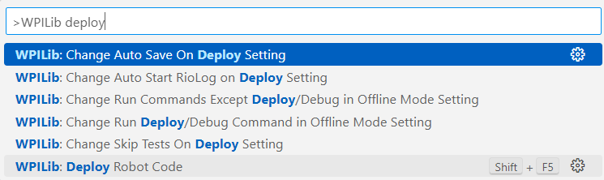
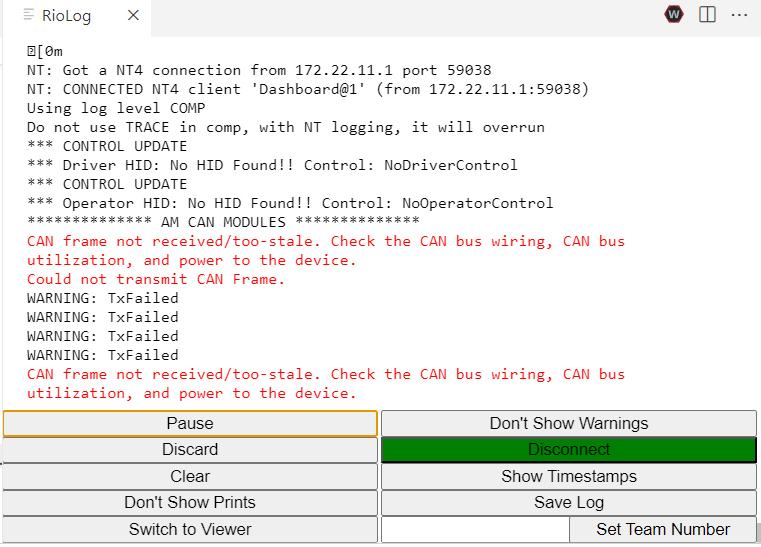
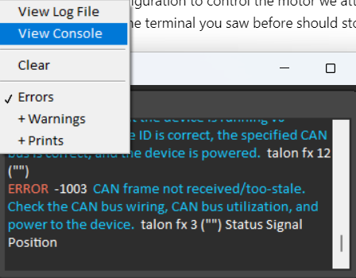

# Deploy to the SystemCore

Your code builds on your laptop. Before changing anything, make sure you
can **deploy** it, which means copying it to a robot controller and
running it there.

1. Ask a mentor for a test board with a SystemCore, and for help powering
   it up. Wait for its screen to show that it has booted.
1. Connect your laptop to the SystemCore with a **USB-C** cable.
   * You can also use Ethernet through the radio or a switch; see
     [SSH and checks](SSH_AND_CHECKS.md#connect-your-laptop).
   * TODO: add a photo of the SystemCore USB-C port.
1. Make sure the project knows our team number:
   `Ctrl+Shift+P` → **WPILib: Set Team Number** → `100`.
1. Click the **W** button in the top right of VS Code (or press
   `Ctrl+Shift+P`) and choose **WPILib: Deploy Robot Code**.

   

1. Watch the terminal. You want `BUILD SUCCESSFUL`, and then the robot
   console output.

   

   (This screenshot is from the RoboRIO; the SystemCore console looks
   similar.)

## Watch the console

Open the **FRC Driver Station** and click the gear icon → **View
Console** to see what the robot code prints.

If you deployed `comp` to a test board, expect **lots of errors**. The
competition code is looking for motors and cameras that your test board
doesn't have. That's fine, and it's why you'll make your own
[study](STUDY.md) next.

## If the deploy fails

* **Can't find the robot:** check the cable, and wait for the SystemCore to
  finish booting. Try `ping robot.local`. More in
  [SSH and checks](SSH_AND_CHECKS.md#common-problems).
* **"Team number not found":** you skipped the **Set Team Number** step.
* **Deploy works but the code crashes:** read the console from the top.
  The first error is the one that matters. See
  [Debugging](DEBUGGING.md).

Next: [Your first motor](FIRST_MOTOR.md)
