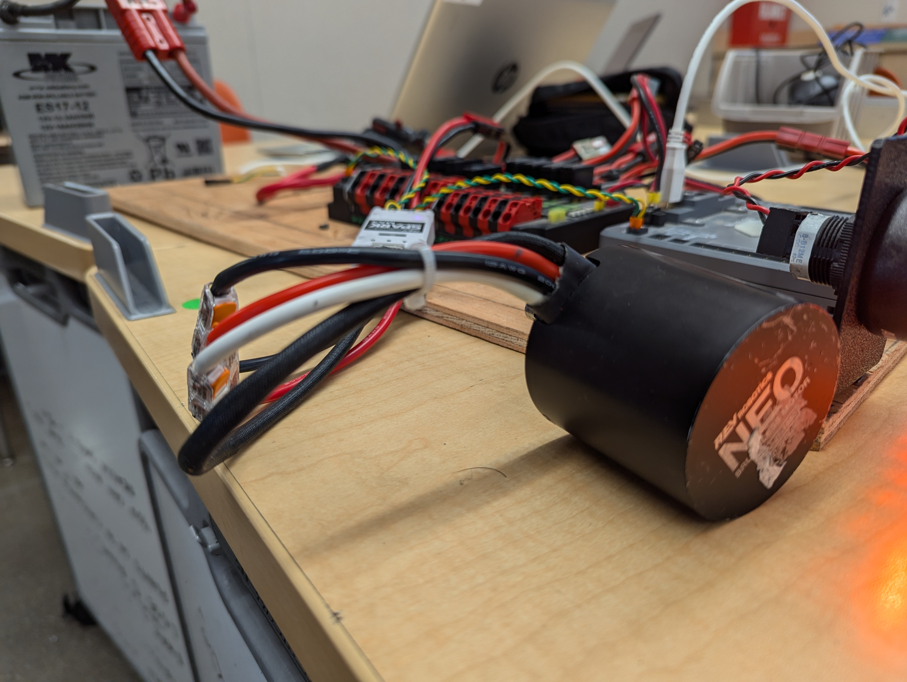
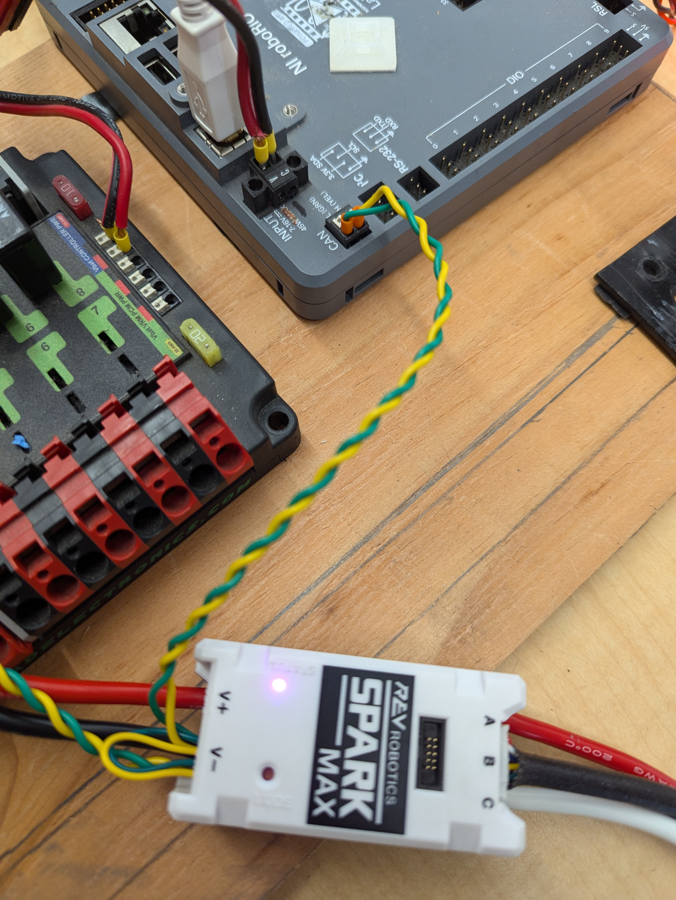
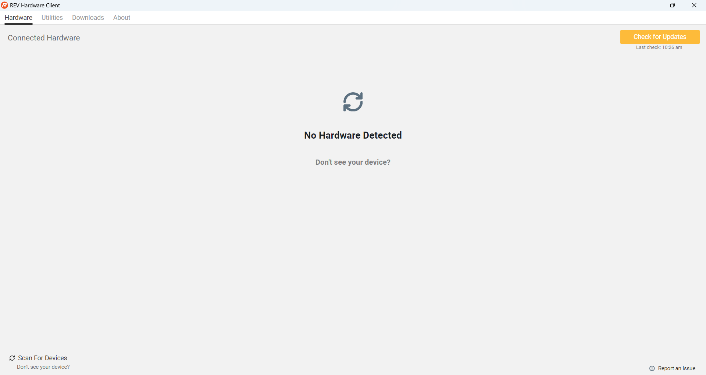
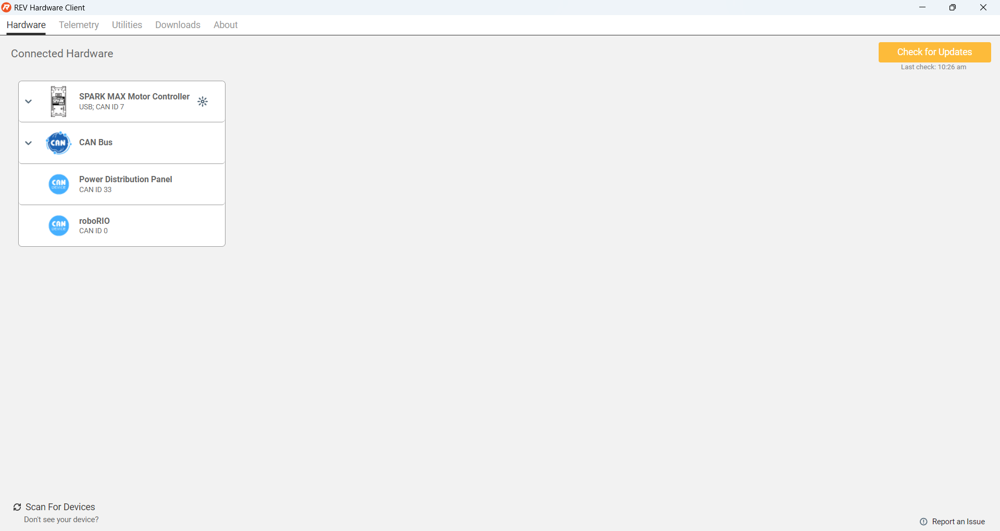
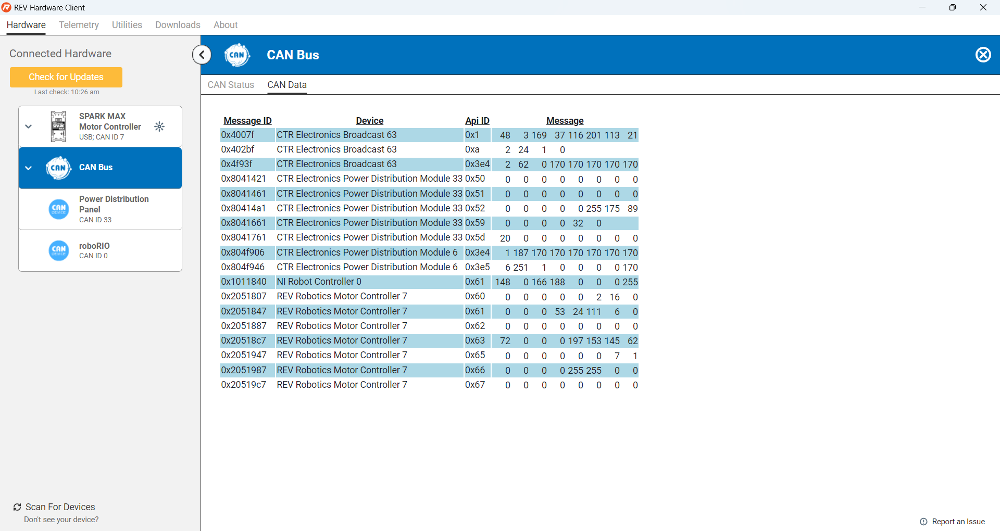
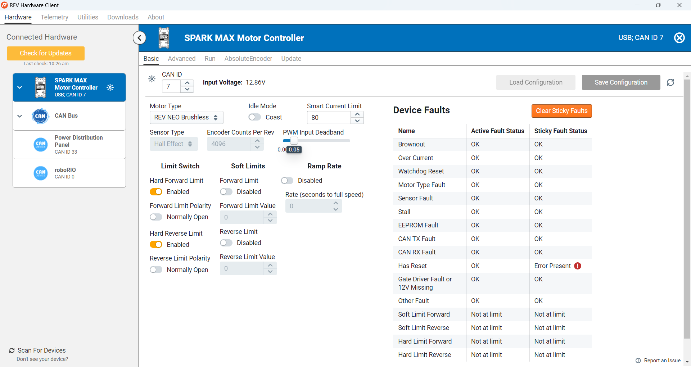

# Your first motor (hardware)

This chapter gets one motor spinning on a **RoboRIO** test board,
**without writing any code**, so you know the wiring is right before you
start programming.

<!--
PHOTO CHECKLIST: take these on a real RoboRIO test board, save them in
readme_img/ with these names, and replace each "TODO photo" note below.
  [ ] roborio_test_board_labeled.jpg  whole board: battery, breaker, PDP/PDH, RoboRIO, motor
  [ ] kraken_x60_x44.jpg          a Kraken X60 and a Kraken X44 side by side
  [ ] kraken_power_can.jpg        Kraken power wires and CAN wires
  [ ] kraken_can_to_roborio.jpg   CAN from the Kraken into the RoboRIO
  [ ] kraken_led_ok.jpg           Kraken status light, healthy
  [ ] tunerx_devices.png          Tuner X device list showing the Kraken
  [ ] tunerx_kraken_config.png    Tuner X device page: CAN ID, firmware
  [ ] tunerx_kraken_plot.png      Tuner X showing supply voltage
  [ ] tunerx_kraken_control.png   Tuner X Control tab running the motor
-->

## The test board

Ask a mentor for a RoboRIO test board and a freshly charged battery.
Clear a few square feet of table, and don't pile your work on top of
something else.

> 📷 **TODO photo:** `readme_img/roborio_test_board_labeled.jpg`: the
> whole board, labeled: battery, main breaker, power distribution,
> RoboRIO, motor.

## Meet the Kraken

The competition robot uses only two kinds of motor, both made by WCP
and controlled with CTRE's software:

* **Kraken X60**: the bigger, stronger one (drive, shooter, and so on).
* **Kraken X44**: smaller and lighter, for mechanisms that don't need
  as much power.

Each Kraken has its **motor controller built in** (a "Talon FX"), so
there's no separate controller box to wire. Everything in this guide
works the same for both. The only difference in code is which class you
use.

## Connect the motor

1. Ask a mentor for a Kraken X60 or X44 and its wiring.

   

   > 📷 **TODO photo:** replace the NEO picture above with
   > `readme_img/kraken_x60_x44.jpg`, a Kraken X60 and X44 side by side,
   > labeled.

1. Connect the Kraken's **power** wires (red and black) to the power
   distribution, and its **CAN** wires to the CAN bus. The CAN wires are
   yellow and green; match them to the labels.

   > 📷 **TODO photo:** `readme_img/kraken_power_can.jpg`: Kraken power
   > wires going to the power distribution, and the CAN wires.

1. Plug the CAN wires into the RoboRIO's **CAN** port. The yellow and
   green slots are labeled.

   

   > 📷 **TODO photo:** replace the SPARK MAX picture above with
   > `readme_img/kraken_can_to_roborio.jpg`: CAN from the Kraken going
   > into the RoboRIO.

1. Turn on the main breaker. The Kraken's status light should come on,
   and the RoboRIO takes about a minute to boot.

   > 📷 **TODO photo:** `readme_img/kraken_led_ok.jpg`: Kraken status
   > light, healthy.

   If the light is off, check its power. If it blinks a strange color,
   look it up in the
   [Talon FX status light guide](https://v6.docs.ctr-electronics.com/en/stable/docs/hardware-reference/talonfx/index.html).

## Find the CAN ID

Every device on a CAN bus has an **ID number**, like a house number on a
street. Two devices with the same ID cause trouble, and "the motor does
nothing" is very often a CAN ID problem.

You read and set a Kraken's ID with **Phoenix Tuner X**. A Kraken has no
USB port, so Tuner X talks to it **through the RoboRIO**. The full
instructions are in the
[Tuner X docs](https://v6.docs.ctr-electronics.com/en/stable/docs/tuner/index.html);
here's the quick version.

1. Find Phoenix Tuner X on the laptop (Windows key, type "Tuner"). If
   it's not there, install it from the Microsoft Store.

   

   > 📷 **TODO screenshot:** replace the REV client picture above with
   > Tuner X's start screen.

1. Connect the laptop to the RoboRIO with a **USB-B** cable.
1. In Tuner X, set the robot address to team **100** (or `172.22.11.2`
   over USB) and open **Devices**. Your Kraken should be in the list.
   * If Tuner X says there's no diagnostic server, it can install a
     temporary one on the RoboRIO for you. Say yes.
     > **TODO:** check the exact Tuner X prompt on our RoboRIO boards.

   

   > 📷 **TODO screenshot:** replace the REV client picture above with
   > `readme_img/tunerx_devices.png`, the Tuner X device list showing
   > the Kraken.

1. **Check the CAN bus.** The Kraken shows up, and its status isn't an
   error. If you have two devices, click **Blink** on one to see which
   motor is which.

   

   > 📷 **TODO screenshot:** replace the REV CAN screenshot above with
   > what "OK" looks like in Tuner X.

1. **Check the power.** Open the Kraken's page. Its supply voltage
   should be about 12 V.

   

   > 📷 **TODO screenshot:** replace the SPARK MAX voltage picture above
   > with `readme_img/tunerx_kraken_plot.png`, Tuner X showing the
   > Kraken's supply voltage.

1. **Write down the CAN ID.** You can change it here if it clashes with
   another device. Also write it on masking tape on the motor.

   > 📷 **TODO screenshot:** `readme_img/tunerx_kraken_config.png`: the
   > Kraken's page in Tuner X, with the CAN ID and firmware version
   > circled.

1. **Update the firmware** if Tuner X says it's out of date.

## Run the motor

1. Open the Kraken's **Control** tab. Choose **duty cycle** and set the
   value to **0.01** (1%).
1. Clear hands away, enable, and run it.
   > **TODO:** check whether Tuner X control needs the robot enabled
   > from the Driver Station, and update this step.

   

   > 📷 **TODO screenshot:** replace the REV "Run Motor" picture above
   > with `readme_img/tunerx_kraken_control.png`.

**Checkpoint:** the motor turns, slowly.

Our [test board setup](https://github.com/Team100/all26/blob/main/lib/doc/setup.md)
has more details.

Next: [Your first study](STUDY.md)
