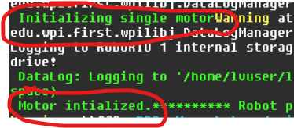
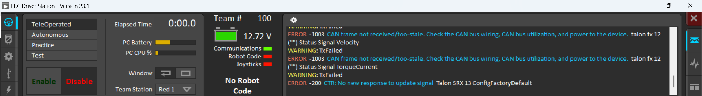

# Control a motor from code

Now for real control code. You'll make the motor spin from your study,
read its speed, and then drive it with an Xbox controller.

You need:

* a [study](STUDY.md) with `lib` included, that builds and deploys
* the NEO + SPARK MAX from [Your first motor](FIRST_MOTOR.md), and its
  CAN ID

Open your study's workspace and find `Robot.java`. For now, you'll put
everything in this one file.

> If the class names below don't match what you see in `lib`, the
> library has moved on. Compare with
> [`test/single_roller/.../Robot.java`](https://github.com/Team100/all26/blob/2027/test/single_roller/src/main/java/first/robot/Robot.java),
> which is always kept building, and fix this page.

## The robot lifecycle

WPILib calls methods in your `Robot` class at certain times:

| Method | When it runs |
| --- | --- |
| `Robot()` (the constructor) | Once, when the code starts |
| `robotPeriodic()` | Every 20 ms (50 times a second), in every mode |
| `teleopInit()` | Once, when teleop is enabled |
| `teleopPeriodic()` | Every 20 ms while teleop is enabled |

Read [WPILib: What is "TimedRobot"?](https://docs.wpilib.org/en/2027/docs/software/vscode-overview/creating-robot-program.html)
to learn more.

## Use the Team 100 robot base

Change your class to extend our version of `TimedRobot`, which adds
better logging:

```java
public class Robot extends TimedRobot100 {
```

You'll need `import org.team100.lib.framework.TimedRobot100;`.
VS Code can add imports for you: hover over the red squiggle and choose
**Quick Fix**.

## Create the motor

Our motor classes are in [`lib/.../motor`](https://github.com/Team100/all26/tree/2027/lib/src/main/java/org/team100/lib/motor).
For a NEO on a SPARK MAX, use
[`NeoCANSparkMotor`](https://github.com/Team100/all26/blob/2027/lib/src/main/java/org/team100/lib/motor/rev/NeoCANSparkMotor.java).
Open it and read the constructor. It needs a lot of arguments:

| Argument | What it is | Use |
| --- | --- | --- |
| `LoggerFactory parent` | Where this motor's logs go | `log.name("motor")` |
| `TotalCurrentLog currentLog` | Adds up the current used by every motor | from `RobotLog` (below) |
| `CanId canId` | The CAN ID you wrote down | `new CanId(7)`, **with your ID** |
| `CanBusId busId` | Which SystemCore CAN port | `new CanBusId(0)` |
| `NeutralMode100 neutral` | What the motor does at zero: coast or brake | `NeutralMode100.COAST` |
| `MotorPhase motorPhase` | Which way is "forward" | `MotorPhase.FORWARD` |
| `CurrentLimit limit` | Maximum current in amps (stator, supply). Low is safe | `new CurrentLimit(10, 10)` |
| `Friction friction` | Feedforward model; not used for duty cycle | `new Friction(0, 0, 0, 0)` |
| `PIDConstants pid` | Feedback control; not used for duty cycle | `PIDConstants.zero()` |
| `int averageDepth`, `int measurementPeriod` | Encoder filtering | `0`, `0` (defaults) |

Put the setup in the constructor:

```java
private final NeoCANSparkMotor m_motor;

public Robot() {
    Startup.start();
    LoggerFactory log = Logging.root();
    RobotLog robotLog = new RobotLog(log);
    TotalCurrentLog currentLog = robotLog.totalCurrentLog();

    System.out.println("Initializing motor");
    m_motor = new NeoCANSparkMotor(
            log.name("motor"),
            currentLog,
            new CanId(7), // YOUR CAN ID, not 7!
            new CanBusId(0),
            NeutralMode100.COAST,
            MotorPhase.FORWARD,
            new CurrentLimit(10, 10),
            new Friction(0, 0, 0, 0),
            PIDConstants.zero(),
            0,
            0);
    System.out.println("Motor initialized");
}
```

Before you build: **you must be able to say what every argument does.**
Open `CurrentLimit`, `Friction`, and `PIDConstants` in `lib/config` and
read their comments.

Build and deploy. **Checkpoint:** you see both messages in the Driver
Station console. They may be mixed in with other output, so look
carefully.



## Keep the library ticking

Add this `robotPeriodic`:

```java
@Override
public void robotPeriodic() {
    Takt.update();
    Cache.refresh();
    CommandScheduler.getInstance().run();
    LogPoller.log();
}
```

* `Takt.update()` moves our clock forward one step.
* `Cache.refresh()` clears saved sensor readings. Asking a motor for
  data is slow, so we **cache** each value: we read it once and reuse it.
  Then we throw the cache away every cycle, or we'd see the same old
  value forever. Read about [caching](https://en.wikipedia.org/wiki/Cache_(computing)).
* `CommandScheduler…run()` runs commands (you'll use these later).
* `LogPoller.log()` sends logs to the dashboard.

## Turn the motor

`setDutyCycle` takes a number from **−1** (full reverse) to **1** (full
forward). Put it in `teleopPeriodic`:

```java
@Override
public void teleopPeriodic() {
    m_motor.setDutyCycle(0.1);
}
```

Deploy and select **TeleOperated** in the Driver Station. Does the motor
turn?

It doesn't, because the robot is **disabled**. Disabled robots never move.
That's a safety rule. Say "Enabling!", keep a finger on **Enter**
(disable), and click **Enable**.

**Checkpoint:** the motor spins at 10%.

## Read the speed

```java
double speed = m_motor.encoder().getVelocityRad_S();
System.out.printf("speed %.2f rad/s%n", speed);
```

Put this in `teleopPeriodic`. What units is the speed in? Use 
[rad/s](https://en.wikipedia.org/wiki/Radian_per_second) to work out
the speed in rotations per second.

> **Experiment:** comment out `Cache.refresh()`, deploy, and watch the
> printed speed. What happens? Why? Then put it back.

## Speed up slowly

Add a field and ramp up a little every cycle, up to a limit:

```java
private double m_dutyCycle = 0.0;
```

```java
// in teleopPeriodic
m_dutyCycle = Math.min(m_dutyCycle + 0.001, 0.3);
m_motor.setDutyCycle(m_dutyCycle);
```

> **Check yourself:** how many seconds does it take to reach 0.3?
> (Hint: how often does `teleopPeriodic` run?)

Where should you reset `m_dutyCycle` to 0, so it starts slow every time
you enable? (Hint: look at the lifecycle table.)

## Drive it with an Xbox controller

Running at a fixed speed is boring. Let's steer with a joystick.

Our controller wrapper is
[`DriverXboxControl`](https://github.com/Team100/all26/blob/2027/lib/src/main/java/org/team100/lib/hid/DriverXboxControl.java).
Add a field and create it in the constructor:

```java
private final DriverXboxControl m_control;
// in the constructor:
m_control = new DriverXboxControl(log, 0);
```

`0` is the controller's slot in the Driver Station's USB tab.

Replace your `teleopPeriodic`:

```java
@Override
public void teleopPeriodic() {
    // Divide by 10 so the motor can't go crazy on a test board.
    double stick = m_control.leftY() / 10;
    System.out.printf("stick %.2f%n", stick);
    m_motor.setDutyCycle(stick);
}
```

Plug the controller into the **laptop** with USB. In the Driver Station,
the USB tab should show it in slot 0. If it says the HID isn't found,
some controllers have an X/D switch; try flipping it.

When everything's ready, all the Driver Station lights are green:



Enable teleop and push the left stick.

**Checkpoint:** the motor follows the stick.

> **Check yourself:** push the stick **up**. Does the printed number go
> up or down? Look up `getLeftY` in the
> [WPILib docs](https://docs.wpilib.org/en/2027/) to find out why. How
> would you make "up" mean "forward"?

## Send it in

Commit, push, and open a PR ([how](FORK_WORKFLOW.md)). In the
description, say what you tested and what you saw.

Next: [Use the simulator](SIMULATOR.md)
