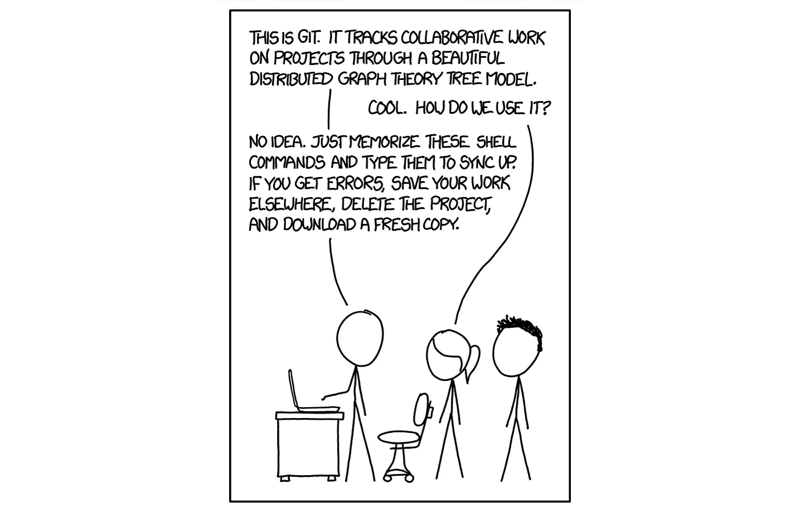
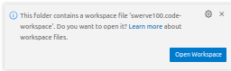

# Set up your laptop and your fork

By the end of this page you will have your own copy of the team code on
GitHub (your *fork*), a copy of it on your laptop, and a successful build.

## The tools, in one paragraph

FRC robots are programmed in [Java](https://dev.java/) using
[WPILib](https://wpilib.org/), the robotics library from
[WPI](https://www.wpi.edu/). You write code in
[VS Code](https://code.visualstudio.com/), and
[Gradle](https://gradle.org/) builds it. [Git](https://git-scm.com/)
tracks every change, and [GitHub](https://github.com/) is where the team
shares code. If VS Code is new to you, do its
[getting started tutorial](https://code.visualstudio.com/docs/getstarted/getting-started).

Git can be a little hard:



If Git is new to you, read GitHub's
[getting started with Git](https://docs.github.com/en/get-started/learning-to-code/getting-started-with-git)
and do the [hello-world](https://docs.github.com/en/get-started/start-your-journey/hello-world)
exercise. It teaches *repository*, *branch*, *commit*, and *pull request*,
which you'll use every day.

## Why a fork?

`Team100/all26` is the team's repository. Students don't push to it
directly. Instead:

```
Team100/all26  ──fork──▶  <you>/all26  ──clone──▶  your laptop
      ▲                        ▲                       │
      └──── pull request ──────┴──────── push ─────────┘
```

* **upstream** = `Team100/all26`, the team's copy
* **origin** = `<you>/all26`, your fork; you can push anything here
* A **pull request (PR)** asks a mentor to merge your changes from your
  fork into upstream

You can't break the team code by pushing to your fork, so experiment
freely.

## Get a laptop

* **Team laptop:** take one of the Windows laptops from the locked cabinet
  and plug it in. The password is written on it. These already have
  WPILib, GitHub Desktop and Git installed, so skip to
  "Make a GitHub account".
* **Your own laptop:** you'll install the tools below.

## Install the tools (own laptop only)

1. **WPILib 2027.** Follow the
   [WPILib installation guide](https://docs.wpilib.org/en/2027/docs/zero-to-robot/step-2/wpilib-setup.html).
   It installs "2027 WPILib VS Code", Java, and the WPILib tools. Use this
   VS Code for robot code, not a different VS Code you already have.
1. **Git.** Windows: install [Git for Windows](https://git-scm.com/download/win)
   and accept the defaults. Mac: run `xcode-select --install`.
1. **GitHub Desktop** (optional but recommended):
   https://desktop.github.com/
1. **Tell Git who you are.** In a terminal:
   ```
   git config --global user.name "Your Name"
   git config --global user.email "you@example.com"
   ```
   Use the same email as your GitHub account.

## Make a GitHub account

Go to https://github.com/signup. Pick a username you're happy for mentors
to see on every PR.

## Fork the team repository

1. Sign in to GitHub and go to https://github.com/Team100/all26
1. Click **Fork** (upper right).
1. **Uncheck "Copy the `main` branch only".** We need the `2027` branch.
1. Click **Create fork**.

You now have `https://github.com/<you>/all26`.

### Turn on GitHub Actions for your fork

GitHub turns off automatic tests on new forks. Go to the **Actions** tab
of your fork and click the button to enable workflows. Now the tests run
every time you push.

## Clone your fork

### With GitHub Desktop

1. **File → Options → Accounts**: sign out of anyone else's account, then
   sign in as you.
1. **File → Clone repository…** and pick `<you>/all26`.
1. Save it in a folder with **your name** in it (e.g.
   `Desktop\alice\all26`), so nobody else uses it by mistake.
1. When it asks "How are you planning to use this fork?", choose
   **To contribute to the parent project**. This sets up `upstream` for you.
1. In the branch menu at the top, switch to **`2027`**.

### Or with the command line

```
git clone https://github.com/<you>/all26.git
cd all26
git remote add upstream https://github.com/Team100/all26.git
git checkout 2027
```

### Check

```
git remote -v
```

should show `origin` pointing at **your** fork and `upstream` pointing at
`Team100/all26`.

## What you just downloaded

`all26` holds *all* of Team 100's code, in one repository (a
"[monorepo](https://en.wikipedia.org/wiki/Monorepo)"):

* **`comp/`**: the competition robot code
* **`lib/`**: our library, shared by every project and reused every year
* **`studies/`**: small experimental projects. **This is where you'll
  work.**
* **`test/`**: small projects for testing one mechanism at a time
* **`raspberry_pi/`**: the Python vision code for the Pi cameras
* **`console/`**: the drivers' button board

## First build

1. Start **2027 WPILib VS Code** (from the desktop icon, not Windows search).
1. **File → Open Folder…** and open `all26/studies/discus`, a good first
   project.
   * Open a single project folder, not the whole `all26` folder. Each
     project builds on its own.
   * Bigger projects like `comp` come with a `.code-workspace` file that
     opens `lib` alongside. When VS Code offers to **Open Workspace**,
     say yes.

     
1. Turn on **File → Auto Save**.
1. Wait. The first build downloads a lot and can take many minutes.
1. Click the WPILib icon (the red "W" in the top right) and choose
   **Build Robot Code**.

**Checkpoint:** the terminal at the bottom ends with `BUILD SUCCESSFUL`.

If it fails, look in [Troubleshooting](TROUBLESHOOTING.md), ask for
help, and add what you learned to that page.

Next: [Day-to-day workflow with your fork](FORK_WORKFLOW.md)
