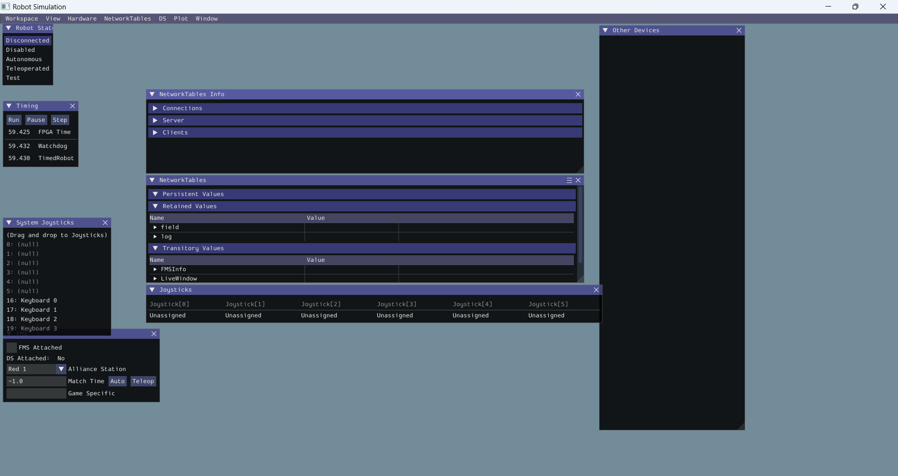
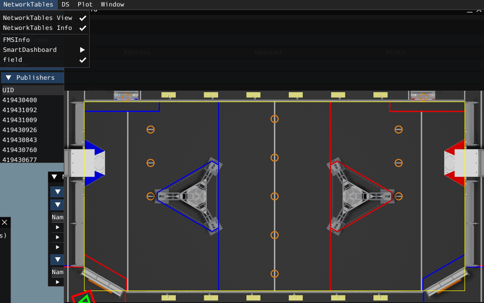
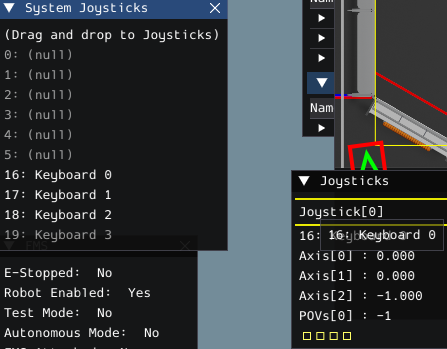
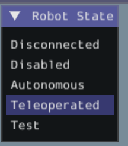
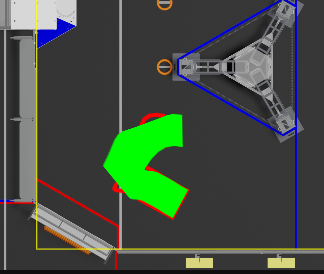
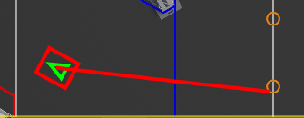
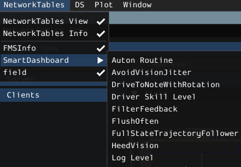

# Use the simulator

WPILib includes a simulator that runs your robot code **on your laptop**,
with no robot. It can't test everything, but it saves a lot of time:
you can try auton paths, check your logic, and find crashes before you
touch hardware.

The official guide is
[here](https://docs.wpilib.org/en/stable/docs/software/wpilib-tools/robot-simulation/simulation-gui.html).

## Start the simulator

1. Open the `comp` folder (or its workspace) in VS Code.
1. `Ctrl+Shift+P` → **WPILib: Simulate Robot Code**.
1. Pick **Sim GUI** only, and nothing else.

You'll get the simulation window:

If it doesn't start, read the terminal for errors, and ask a mentor if
it's stuck.

## The field view

Open **NetworkTables → Field** if you don't see the field.

If there's no Field option, your robot code probably crashed or hit a
breakpoint. Check the terminal. More about the field widget is
[here](https://docs.wpilib.org/en/stable/docs/software/dashboards/glass/field2d-widget.html).

## Drive with the keyboard

1. Drag **Keyboard 0** onto **Joystick[0]**.

   

1. Select **Teleoperated** in the Robot State widget.

   

1. `W A S D` move the robot (axes 0 and 1). `E R` rotate it (axis 2).

> **Check yourself:** which way does the robot move when you press `W`?
> Is that +x on the field? (See [Auton](AUTON.md#pose-where-am-i).)

## Run an auton

1. Choose an auton in **NetworkTables → SmartDashboard → Auton Command**.
   While disabled, its path is drawn on the field.
1. Click **Autonomous** in Robot State.
1. Watch the robot drive the trajectory.

   

1. To tidy up the drawing, open the field's menu (top right) →
   **Trajectory** and turn off the arrows.

   

For more detail in the logs, set **SmartDashboard → Log Level** to
`TRACE`.

Next: [Glass and power-draw tests](GLASS_POWER.md)
