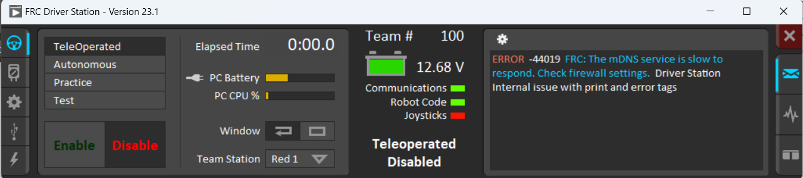

# Your first study

The `comp` project is the competition robot. It sets up dozens of motors,
sensors, and cameras, and on a test board it will complain that it can't
find any of them. Changing it to fit your test board would take forever.

Instead, start a *completely new* small project. We call these
**studies**. A study teaches you the simplest way to control a robot,
and you build on it from there.

Do this on a branch in your fork ([how](FORK_WORKFLOW.md)), e.g.
`alice/first-study`.

## Create the study

Use the WPILib project wizard, in **2026 WPILib VS Code**:

1. `Ctrl+Shift+P` → **WPILib: Create a new project**.
1. Choose **Template** → **Java** → **Timed Robot**.
1. For the folder, pick `all26/studies`.
1. Name it something that describes your project and includes your
   name, e.g. `alice_first_motor`.
1. Team number: `100`.
1. Click **Generate Project**, and open it when VS Code asks.

> **TODO:** check these wizard steps in 2026 WPILib, and add a
> screenshot.

> 📷 **TODO screenshot:** `readme_img/wpilib_new_project.png`: the
> wizard filled in.

## Make sure build and deploy work

Build first: `Ctrl+Shift+P` → **WPILib: Build Robot Code**. Then
[deploy](DEPLOY.md) to a RoboRIO test board.

**Checkpoint:** in the Driver Station, Communications and Robot Code are
both **green**, and no errors are scrolling in the console.



## Include the `lib` directory

Starting from scratch is daunting. Luckily, most of what you need
(motors, sensors, logging, controllers) is already in our `lib` folder.
There are three steps to use it.

### 1. Make a workspace

VS Code opened only your study folder, but you want `lib` open too. A
**workspace** is a file that tells VS Code to open several folders
together.

1. **File → Add Folder to Workspace…** and choose `all26/lib`.
1. **File → Save Workspace As…** and save it **inside your study
   folder**, next to `build.gradle`.

It should look like this:

```json
{
  "folders": [
    { "path": "." },
    { "path": "../../lib" }
  ],
  "settings": {
    "java.configuration.updateBuildConfiguration": "automatic",
    "java.server.launchMode": "Standard"
  }
}
```

From now on, open your study by opening this `.code-workspace` file.
For an example, see `test/single_roller/single_roller.code-workspace`.

### 2. Tell Gradle about `lib`

In your study's `build.gradle`, add this just after the `plugins { … }`
block at the top:

```gradle
sourceSets {
    main {
        java {
            srcDir "../../lib/src/main/java"
        }
    }
}
```

> **Check yourself:** what does `../../` mean in that path? Why two?

### 3. Copy the vendordeps

**Vendordeps** are the libraries from motor and sensor makers (CTRE,
REV, Redux). `lib` uses them, so your study needs them too.

1. In the Explorer, open `lib/vendordeps`.
1. Select **all** the `.json` files there, right-click → **Copy**.
1. Right-click **your** study's `vendordeps` folder → **Paste**. Say yes
   to replacing `WPILibNewCommands.json` if it asks.

Your `vendordeps` should now have the same files as `lib/vendordeps`.

## Build again

Build and deploy again. Always check that everything still works before
you change anything else.

**Checkpoint:** `BUILD SUCCESSFUL`, and green lights in the Driver
Station.

If you get stuck, compare your study with
[`test/single_roller`](https://github.com/Team100/all26/tree/main/test/single_roller), which is set up exactly
this way.

## Send a pull request

Commit and push your new study, then open a PR
([how](FORK_WORKFLOW.md)). This first PR is mostly template code, which
is fine. It's quick to review, and your *real* changes come next in
their own PR, where they're easy to see.

Next: [Control a motor from code](MOTOR_CODE.md)
