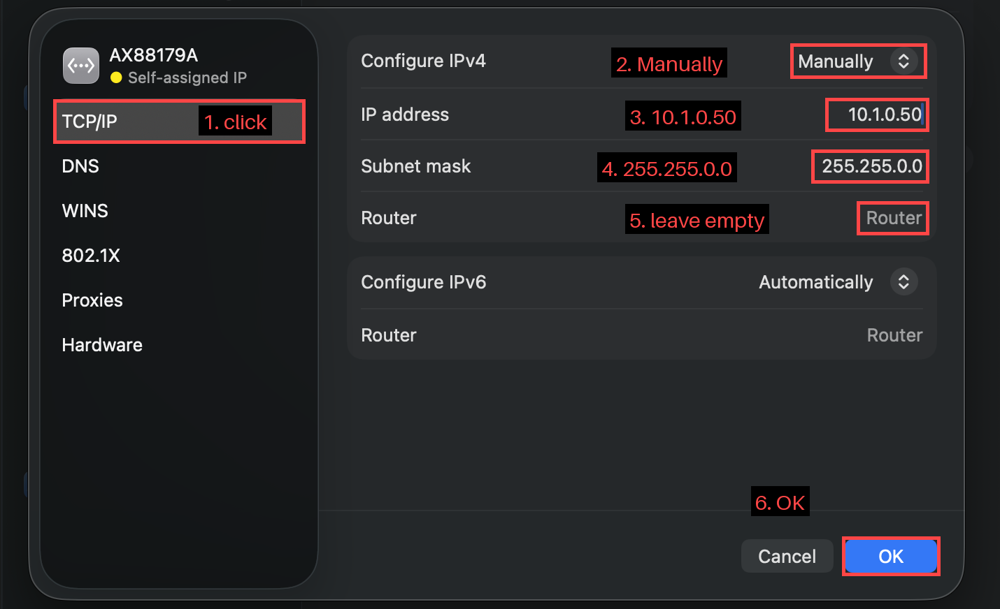

# Deploy to the RoboRIO

Your code builds on your laptop. Before changing anything, make sure you
can **deploy** it, which means copying it to a robot controller and
running it there. For now that's a **RoboRIO** test board.

1. Ask a mentor for a RoboRIO test board, and for help powering it up.
   Wait about a minute for it to boot.

   > 📷 **TODO photo:** `docs/img/roborio_test_board.jpg`: the RoboRIO
   > test board, powered up.

1. Connect your laptop to the RoboRIO with a **USB-B** cable (the square
   "printer" kind).

   > 📷 **TODO photo:** `docs/img/roborio_usb_b.jpg`: the USB-B cable
   > plugged into the RoboRIO.

1. Make sure the project knows our team number:
   `Ctrl+Shift+P` → **WPILib: Set Team Number** → `100`.

   > 🖥️ **Advanced:** open `.wpilib/wpilib_preferences.json` in your
   > project and check it says `"teamNumber": 100`.

1. Click the **W** button in the top right of VS Code (or press
   `Ctrl+Shift+P`) and choose **WPILib: Deploy Robot Code**.

   

   > 🖥️ **Advanced:** in a terminal, run `./gradlew deploy` ([how](01_SETUP.md#advanced-run-commands-from-a-terminal)).

1. Watch the terminal. You want `BUILD SUCCESSFUL`, and then the robot
   console output.

   

## Watch the console

Open the **FRC Driver Station** and click the gear icon → **View
Console** to see what the robot code prints.


If you deployed `comp` to a test board, expect **lots of errors**. The
competition code is looking for motors and cameras that your test board
doesn't have. That's fine, and it's why you'll make your own
[study](06_STUDY.md) soon.

## If the deploy fails

* **Can't find the robot:** check the cable, and wait for the RoboRIO to
  finish booting. Try `ping roboRIO-100-FRC.local` or
  `ping 172.22.11.2` (the RoboRIO's USB address). On a Mac, add `-c 4`
  (`ping -c 4 172.22.11.2`) so it stops after 4 tries, and see
  [Using a Mac with an Ethernet cable](#using-a-mac-with-an-ethernet-cable).
* **"Team number not found":** you skipped the **Set Team Number** step.
* **Deploy works but the code crashes:** read the console from the top.
  The first error is the one that matters. See
  [Debugging](../reference/DEBUGGING.md).

## Using a Mac with an Ethernet cable

Macs can build and deploy, but they connect to the RoboRIO differently:
use an **Ethernet cable** (a USB or Thunderbolt Ethernet adapter is
fine) from the Mac into the RoboRIO's Ethernet port. If the deploy
can't find the robot, work through these steps **in order**. Each one
checks one link in the chain, so you know exactly where it breaks.

> The **FRC Driver Station only runs on Windows**, so a Mac can deploy
> but can't enable the robot. For anything that has to *move*, a team
> Windows laptop runs the Driver Station (it can be plugged in at the
> same time, over USB).

### What's an IP address?

Every device on a network has an **IP address**, like a phone number,
e.g. `10.1.0.2`. To call each other, two devices must be on the same
**network**: their numbers have to start the same way (like the same
area code). `10.1.0.2` and `10.1.0.50` can talk; `10.1.0.2` and
`169.254.3.7` can't.

Devices also have **names**, like `roboRIO-100-FRC.local`, so you don't
have to remember numbers. Your Mac looks the name up to find the number
(the `.local` part means "ask the devices on this cable").

**`ping`** is how you check whether two devices can talk: it sends a
tiny "hello?" message and waits for an answer.

> On a Mac, `ping` **never stops by itself**. That's why every `ping`
> on this page has **`-c 4`**: send 4 tries, then stop. If you forget
> it, press **`Ctrl+C`** to stop. (On Windows, `ping` stops after 4
> tries on its own.)

### Step 1: Is the cable connected?

1. Turn **Wi-Fi off** for now, so the Mac only has one network to think
   about.
1. Open **System Settings → Network**. Find your Ethernet adapter
   (it may be called **Ethernet**, **USB 10/100/1000 LAN**,
   **Thunderbolt Ethernet**, or a chip name like **AX88179A**). It should have a **green dot** and say
   **Connected**.

   > 📷 **TODO screenshot:** `docs/img/mac_network_list.png`: System
   > Settings → Network, with the Ethernet adapter's green dot and
   > "Connected" circled, and Wi-Fi off.
1. The lights next to the RoboRIO's Ethernet port should be on or
   blinking.

Red or yellow dot, or no lights? Try another cable or adapter, and make
sure the RoboRIO is powered and has finished booting (about a minute).

### Step 2: Ping the RoboRIO by name

Open **Terminal** and run:

```
ping -c 4 roboRIO-100-FRC.local
```

> 📷 **TODO screenshot:** `docs/img/mac_ping_ok.png`: Terminal showing
> `ping` getting `64 bytes from ...` answers.

* **Lines like `64 bytes from 10.1.0.2: ... time=1.2 ms`:** it answers!
  Note the number in that line: that's the
  RoboRIO's IP address. Skip to [Step 5](#step-5-deploy).
* **`cannot resolve`** or **`Request timeout`:** the Mac can't find it
  by name. Go to Step 3.

### Step 3: Check your Mac's IP address

In **System Settings → Network → (your Ethernet adapter) → Details →
TCP/IP**, look at **IP address**.

> 📷 **TODO screenshot:** `docs/img/mac_network_details.png`: the
> Ethernet adapter's page, with the **Details…** button circled.

> 📷 **TODO screenshot:** `docs/img/mac_tcpip_selfassigned.png`: the
> TCP/IP tab showing a `169.254.x.x` self-assigned address.

Or, in Terminal:

```
ifconfig | grep "inet "
```

(Ignore `127.0.0.1`; that's the Mac talking to itself.)

* **`169.254.something`:** the Mac couldn't get an address from anyone,
  so it made one up ("self-assigned"). The RoboRIO usually does the
  same on a direct cable, and then the name from Step 2 should work.
  Wait a minute after plugging in, and try Step 2 again. Still nothing?
  Go to Step 4.
* **`10.1.0.something`:** you're on the robot's network. Try
  `ping -c 4 10.1.0.2`.

### Step 4: Give your Mac a fixed address

Many of our RoboRIOs are set to the fixed address **`10.1.0.2`**. Your
Mac needs an address on the same network:

1. **System Settings → Network → (your Ethernet adapter) → Details →
   TCP/IP.**
1. **Configure IPv4: Manually.**
1. **IP address:** `10.1.0.50`. **Subnet mask:** `255.255.0.0`.
   Leave **Router** empty. Click **OK**.

   

   Two Macs on the same robot? Each needs its own number: use
   `10.1.0.50`, `10.1.0.51`, and so on. (Don't use `10.1.0.2`; that's
   the RoboRIO.)
1. In Terminal: `ping -c 4 10.1.0.2`.

> **TODO:** check which of our RoboRIO test boards use a fixed
> `10.1.0.2` and which use automatic addresses, and write it on each
> board.

**When you're done**, set **Configure IPv4** back to **Using DHCP**, or
your Mac won't work on other networks (like home Wi-Fi over Ethernet).

### Step 5: Deploy

Once `ping` works, deploy from the terminal so you can see everything
([how](01_SETUP.md#advanced-run-commands-from-a-terminal)):

```
./gradlew deploy
```

* It lists every address it tries. Is the one that answered your `ping`
  in the list?
* `ping` works but deploy still fails? Then it's not a network problem.
  Check that `.wpilib/wpilib_preferences.json` says `"teamNumber": 100`,
  and read the **first** `error:` line. Post that line in Slack.

**Checkpoint:** `BUILD SUCCESSFUL`, and the deploy says which address
it used.

Next: [Your first motor](05_FIRST_MOTOR.md)
