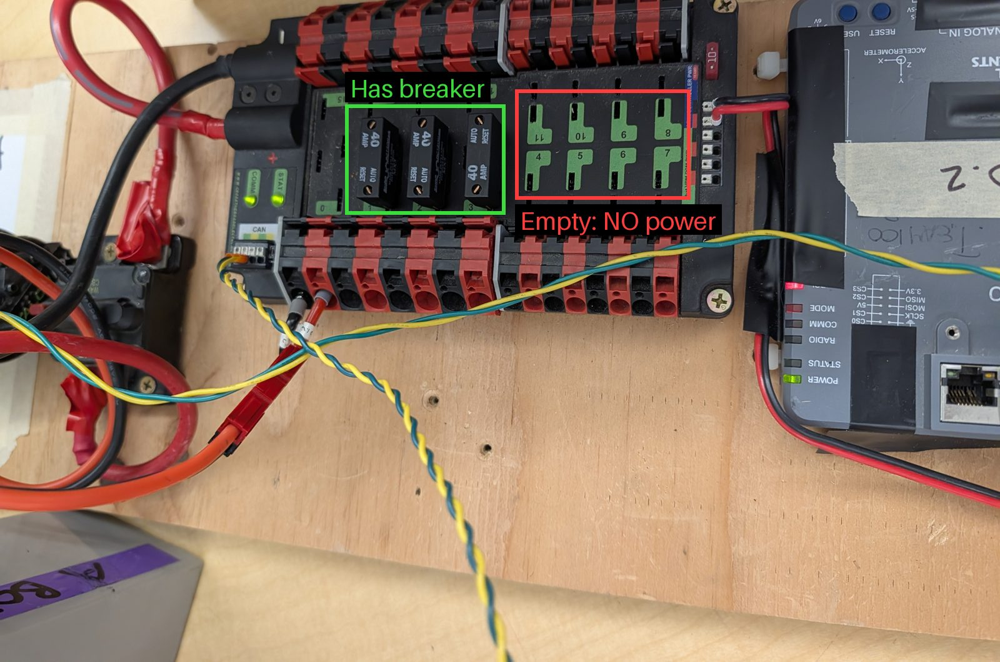
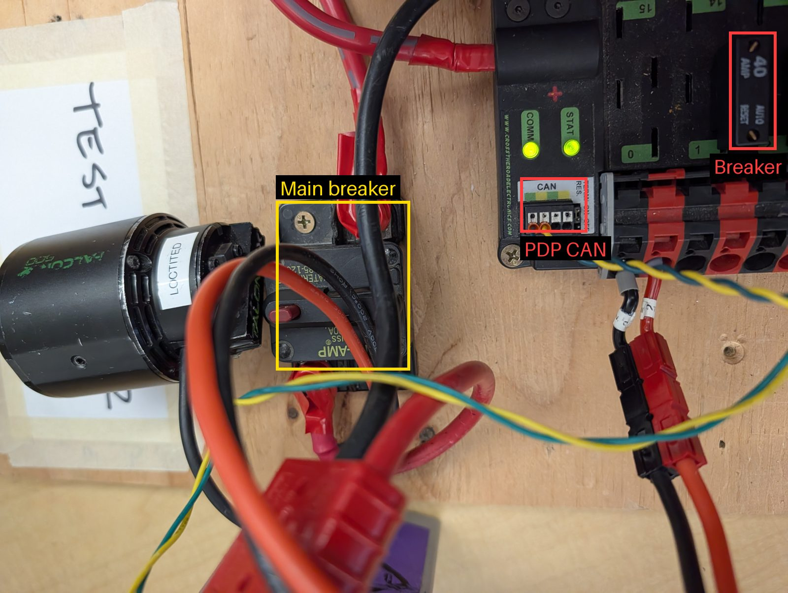
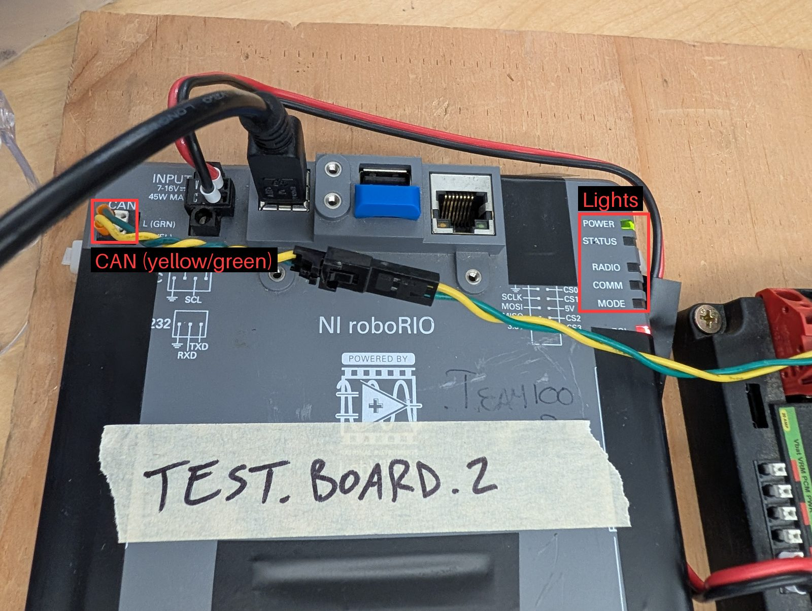
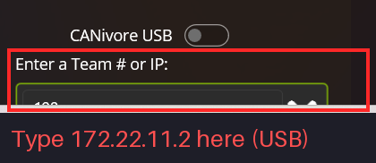
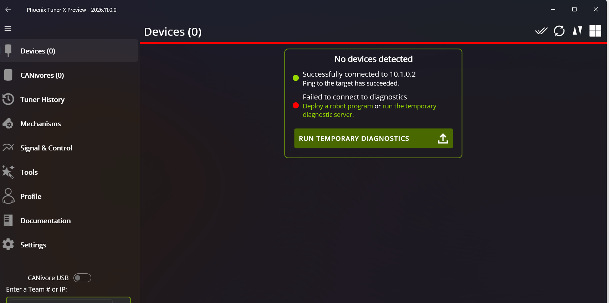
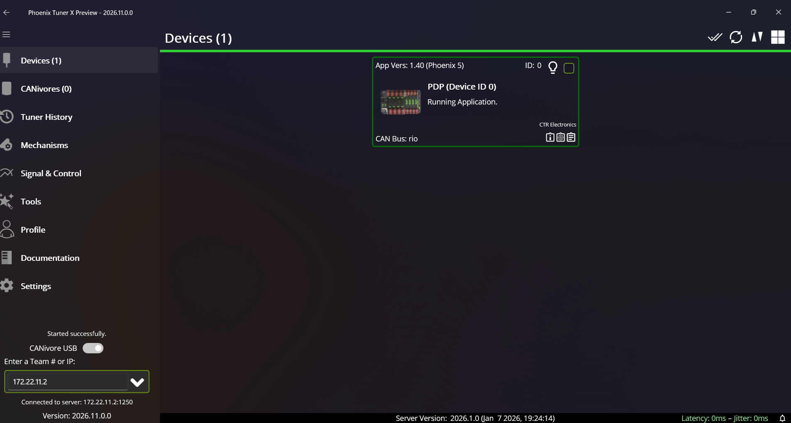
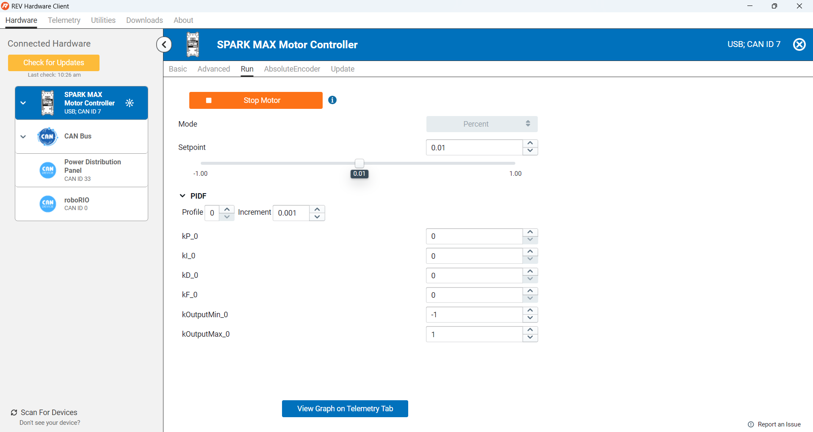

# Your first motor (hardware)

This chapter gets one motor spinning on a **RoboRIO** test board,
**without writing any code**, so you know the wiring is right before you
start programming.

<!--
PHOTO CHECKLIST: take these on a real RoboRIO test board, save them in
docs/img/ with these names, and replace each "TODO photo" note below.
  [ ] roborio_test_board_labeled.jpg  whole board: battery, breaker, PDP/PDH, RoboRIO, motor
  [ ] kraken_x60_x44.jpg          a Kraken X60 and a Kraken X44 side by side
  [ ] kraken_power_can.jpg        Kraken power wires and CAN wires
  [x] pdp_can_breaker.jpg         PDP CAN port, a breaker, main breaker (motor shown is a Falcon)
  [x] pdp_breaker.jpg             PDP slots with and without breakers
  [x] roborio_can_lights.jpg      RoboRIO CAN port and lights
  [ ] kraken_can_to_roborio.jpg   CAN from the Kraken into the RoboRIO
  [ ] kraken_led_ok.jpg           Kraken status light, healthy
  [x] tunerx_team_or_ip.png       Tuner X "Enter a Team # or IP" box (cropped)
  [x] tunerx_no_diagnostics.png   Tuner X "Failed to connect to diagnostics"
  [ ] tunerx_devices.png          Tuner X device list showing the Kraken
  [ ] tunerx_kraken_config.png    Tuner X device page: CAN ID, firmware
  [ ] tunerx_kraken_plot.png      Tuner X showing supply voltage
  [ ] tunerx_kraken_control.png   Tuner X Control tab running the motor
-->

## The test board

Ask a mentor for a RoboRIO test board and a freshly charged battery.
Clear a few square feet of table, and don't pile your work on top of
something else.

> 📷 **TODO photo:** `docs/img/roborio_test_board_labeled.jpg`: the
> whole board, labeled: battery, main breaker, power distribution,
> RoboRIO, motor.

## Meet the Kraken

The competition robot uses only two kinds of motor, both made by WCP
and controlled with CTRE's software:

* **Kraken X60**: the bigger, stronger one (drive, shooter, and so on).
* **Kraken X44**: smaller and lighter, for mechanisms that don't need
  as much power.

Each Kraken has its **motor controller built in** (a "Talon FX"), so
there's no separate controller box to wire. Everything in this guide
works the same for both. The only difference in code is which class you
use.

## Connect the motor

1. Ask a mentor for a Kraken X60 or X44 and its wiring.

   

   > 📷 **TODO photo:** replace the NEO picture above with
   > `docs/img/kraken_x60_x44.jpg`, a Kraken X60 and X44 side by side,
   > labeled.

1. Connect the Kraken's **power** wires (red and black) to a slot on
   the power distribution panel (PDP), and its **CAN** wires to the CAN
   bus. The CAN wires are yellow and green; match them to the labels.
1. **Put a breaker in that PDP slot.** Every motor slot needs its own
   small snap-in **breaker** (people often call it a **fuse**), usually
   20 A or 40 A. With no breaker, that slot gets no power, even though
   everything else on the board lights up.

   

   Here's a close-up of the PDP: its CAN port, a breaker in a slot, and
   the board's **main breaker** (the big switch that turns the whole
   board on and off). The motor in this picture is an older Falcon;
   a Kraken wires up the same way.

   

   > 📷 **TODO photo:** `docs/img/kraken_power_can.jpg`: a Kraken's power
   > wires going to the power distribution, and its CAN wires.

1. Plug the CAN wires into the RoboRIO's **CAN** port. The yellow and
   green slots are labeled.

   

1. Turn on the main breaker. The Kraken's status light should come on,
   and the RoboRIO takes about a minute to boot.

   > 📷 **TODO photo:** `docs/img/kraken_led_ok.jpg`: Kraken status
   > light, healthy.

   If the light is off, check its power. If it blinks a strange color,
   look it up in the
   [Talon FX status light guide](https://v6.docs.ctr-electronics.com/en/stable/docs/hardware-reference/talonfx/index.html).

1. Check the RoboRIO's lights. **Don't worry if Comm is off.** Comm
   means "talking to the **Driver Station**", not "the USB cable is
   plugged in", and you don't need the Driver Station for this chapter.

   | Light | What you want now | Meaning |
   | --- | --- | --- |
   | Power | Green | It has power |
   | Status | Off (after booting) | On while booting; **blinking** means an error |
   | Comm | Off is fine | Off: no Driver Station. Solid red: Driver Station, but no robot code. Blinking red: e-stopped. Green: Driver Station and robot code |

   The picture above shows the lights after booting: **Power** green,
   **Status** and **Comm** off. That's what you want.

## Find the CAN ID

Every device on a CAN bus has an **ID number**, like a house number on a
street. Two devices with the same ID cause trouble, and "the motor does
nothing" is very often a CAN ID problem.

You read and set a Kraken's ID with **Phoenix Tuner X**. A Kraken has no
USB port, so Tuner X talks to it **through the RoboRIO**. The full
instructions are in the
[Tuner X docs](https://v6.docs.ctr-electronics.com/en/stable/docs/tuner/index.html);
here's the quick version.

1. Find Phoenix Tuner X on the laptop (Windows key, type "Tuner").
   **Team laptops already have it, so use one.** If you need to install
   it, here's where it's free:
   * **Windows:** free from the
     [Microsoft Store](https://apps.microsoft.com/search?query=phoenix+tuner+x),
     or with CTRE's
     [Phoenix offline installer](https://github.com/CrossTheRoadElec/Phoenix-Releases/releases).
   * **Mac:** the Mac App Store charges for it (about $4). Don't buy it;
     use a team Windows laptop instead.
   * You can ignore anything about **Phoenix Pro** licenses. We don't
     need them to find or set a CAN ID or update firmware.

   > **TODO:** check whether the Android (Google Play) version is free
   > and can connect to the RoboRIO.

   

   > 📷 **TODO screenshot:** replace the REV client picture above with
   > Tuner X's start screen.

1. Connect the laptop to the RoboRIO with a **USB-B** cable.
1. **Use only the USB cable.** Unplug the laptop's Ethernet and turn off
   its Wi-Fi if it's on a robot network. Otherwise Tuner X may find a
   different robot instead of yours.
1. In Tuner X, type **`172.22.11.2`** in **Enter a Team # or IP**
   (bottom left). That's the RoboRIO's address over USB. Don't type
   `100` here: that looks for `10.1.0.2`, which is the robot network,
   not your USB cable.

   
1. Set Tuner X's **SSH login** for a RoboRIO: username **`admin`**,
   **no password**. New versions of Tuner X default to `systemcore`
   (for the new controller), which a RoboRIO doesn't accept.
   > **TODO:** add exactly where this setting is in Tuner X, with a
   > screenshot (`docs/img/tunerx_ssh_login.png`).
1. Open **Devices**. The box should say **"Successfully connected to
   172.22.11.2"**. If it says `10.1.0.2`, go back a step.
1. You'll probably also see **"Failed to connect to diagnostics"**.
   That's normal: Tuner X needs a small CTRE program (the *diagnostic
   server*) running on the RoboRIO, and our robot code is what usually
   starts it. With no code deployed yet, click **RUN TEMPORARY
   DIAGNOSTICS**. It lasts until the RoboRIO reboots, so you'll need to
   click it again after a power cycle.

   

   > (This picture shows `10.1.0.2`; yours should say `172.22.11.2`.)

1. **You're doing well if** the bottom left says **"Connected to
   server: 172.22.11.2:1250"** and **Devices** lists something. The
   **PDP** (power distribution panel, ID 0) is on the CAN bus too, so
   you'll see it. Your **Kraken** should be in the list next to it.

   

   > 📷 **TODO screenshot:** retake this with the Kraken in the list too.

   > [!WARNING]
   > **(!!!) Only the PDP, no Kraken? Check the breaker (fuse) first!**
   > Look at the Kraken's PDP slot. If there's no breaker plugged in,
   > the Kraken gets **no power** and its light is **off**, even though
   > the RoboRIO and PDP are on. Turn off the main breaker, plug a
   > breaker into the slot, turn power back on, and click refresh in
   > Tuner X. This is exactly what happened on our first day.

   Still missing? See "the PDP shows up, but not the Kraken" in
   [Troubleshooting](../reference/TROUBLESHOOTING.md).

   **Got "Error retrieving SSH target platform" instead?** Tuner X logs
   into the RoboRIO with SSH to start the temporary server, and that
   failed.
   1. Check the address is `172.22.11.2`, not `10.1.0.2`.
   1. Check Tuner X's SSH login is `admin` with no password, not
      `systemcore`.
   1. Check SSH yourself. In PowerShell, run `ssh admin@172.22.11.2`;
      the password is blank, so just press Enter. If that fails, the
      RoboRIO isn't reachable: try another USB cable, and wait for it to
      finish booting. If it asks for a password and blank doesn't work,
      ask a mentor. Type `exit` to log out.
   1. Still stuck? Skip the temporary server: ask a mentor to deploy
      [`test/single_roller`](https://github.com/Team100/all26/tree/main/test/single_roller)
      ([how](04_DEPLOY.md)). Robot code that uses a CTRE motor starts the
      diagnostic server by itself. Then refresh Tuner X.

   

   > 📷 **TODO screenshot:** replace the REV client picture above with
   > `docs/img/tunerx_devices.png`, the Tuner X device list showing
   > the Kraken.

1. **Check the CAN bus.** The Kraken shows up, and its status isn't an
   error. If you have two devices, click **Blink** on one to see which
   motor is which.

   

   > 📷 **TODO screenshot:** replace the REV CAN screenshot above with
   > what "OK" looks like in Tuner X.

1. **Check the power.** Open the Kraken's page. Its supply voltage
   should be about 12 V.

   

   > 📷 **TODO screenshot:** replace the SPARK MAX voltage picture above
   > with `docs/img/tunerx_kraken_plot.png`, Tuner X showing the
   > Kraken's supply voltage.

1. **Write down the CAN ID.** You can change it here if it clashes with
   another device. Also write it on masking tape on the motor.

   > 📷 **TODO screenshot:** `docs/img/tunerx_kraken_config.png`: the
   > Kraken's page in Tuner X, with the CAN ID and firmware version
   > circled.

1. **Update the firmware** if Tuner X says it's out of date.

### Advanced mode: find the ID with code

No Tuner X? You can write robot code that **scans** the CAN bus: try
every possible ID and print the ones that answer. Come back to this
after [Your first study](06_STUDY.md), once you can build and deploy a
study.

The idea:

* A Kraken's ID is a number from **0 to 62**.
* CTRE's library has a
  [`TalonFX`](https://api.ctr-electronics.com/phoenix6/stable/java/com/ctre/phoenix6/hardware/TalonFX.html)
  class for talking to a Kraken. `new TalonFX(7)` means "the Kraken with
  ID 7", even if there isn't one.
* `isConnected()` tells you whether that ID has actually sent anything
  lately.

So: make a `TalonFX` for every ID, wait a moment, and print every ID
where `isConnected()` is true.

Hint 1: where does the code go?

Make the 63 `TalonFX` objects **once**, in the `Robot` constructor, and
keep them in an array field. Check them later, not straight away.

Hint 2: why wait?

Right after you create a `TalonFX`, it hasn't heard from the motor yet,
so `isConnected()` is false for every ID. Give it a second or two. One
way: check in `disabledPeriodic()`, which runs every 20 ms while the
robot is disabled. How many calls is one second?

Hint 3: don't flood the console

`disabledPeriodic()` runs 50 times a second. Print the list once (keep a
`boolean` field that remembers you already printed), or only every few
seconds.

> **Check yourself:** your scan prints **nothing**. List three different
> things that could be wrong, and how you'd check each one. (Think about
> wiring, power, and your code.)

**Checkpoint:** your scan prints the same ID that's written on the
motor's masking tape. Changing an ID or updating firmware still needs
Tuner X.

## Run the motor

1. Open the Kraken's **Control** tab. Choose **duty cycle** and set the
   value to **0.01** (1%).
1. Clear hands away, enable, and run it.
   > **TODO:** check whether Tuner X control needs the robot enabled
   > from the Driver Station, and update this step.

   

   > 📷 **TODO screenshot:** replace the REV "Run Motor" picture above
   > with `docs/img/tunerx_kraken_control.png`.

**Checkpoint:** the motor turns, slowly.

Our [test board setup](https://github.com/Team100/all26/blob/main/lib/doc/setup.md)
has more details.

Next: [Your first study](06_STUDY.md)
