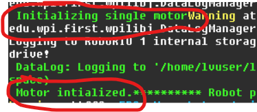
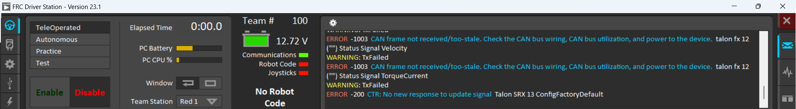

# Control a motor from code

Now you'll write real control code: make the motor spin from your study,
read its speed, ramp it up gently, and drive it with an Xbox
controller. Next you'll ask for a **speed** instead of a power, turn
it to an **angle**, and finish by building a two-motor **grabber**.

This chapter doesn't hand you the code. Each step says **what to
build** and **where to look**, then has a **checkpoint**. If you're
stuck, open the hints **one at a time**, and really try before opening
the next one. Figuring it out is the point. It's also how you'll work
on the real robot code, where nobody has written the answer down.

You need:

* a [study](07_STUDY.md) with `lib` included, that builds and deploys
* a motor and its CAN ID: a **Kraken** (CTRE) from
  [Your first motor](05_FIRST_MOTOR.md), or a **REV** motor (NEO, NEO
  Vortex, NEO 550, or Minion) on a **SPARK MAX** or **SPARK Flex**
  controller. For REV, you find the CAN ID with the **REV Hardware
  Client** instead of Tuner X (see the
  [shooter bot appendix](../part2/03_DEMO_BOT.md#appendix-find-the-can-ids-yourself)).

Every step works for **both kinds**. Where they differ, the step says
so.

Open your study's workspace and find `Robot.java`. For now, everything
goes in this one file.

## Working examples to learn from

When you're stuck, **look at how working code does it**. Reading
working code is a real skill: find the part you need and understand it,
rather than copying the whole thing. No single example matches this
chapter exactly, so each step points you at the right one:

| For | Look at | What to ignore |
| --- | --- | --- |
| Step 2: the every-cycle calls | [`test/single_roller` `Robot.java`](https://github.com/Team100/all26/blob/main/test/single_roller/src/main/java/frc/robot/Robot.java), its `robotPeriodic()` | Everything else. It hides its motor **inside** a `SingleRollerSubsystem`, so you won't find a motor class there. |
| Step 3: creating a motor | [`studies/music` `Robot.java`](https://github.com/Team100/all26/blob/main/studies/music/src/main/java/frc/robot/Robot.java), the `if (MOTOR)` block in its constructor | The music parts (`Player`, `Play`). It uses `KrakenX44Motor`; yours may be a different class. |
| Steps 4 to 12 | No example: this is where you figure it out | |

## The robot lifecycle

WPILib calls methods in your `Robot` class at certain times:

| Method | When it runs |
| --- | --- |
| `Robot()` (the constructor) | Once, when the code starts |
| `robotPeriodic()` | Every 20 ms (50 times a second), in every mode |
| `teleopInit()` | Once, when teleop is enabled |
| `teleopPeriodic()` | Every 20 ms while teleop is enabled |

Read [WPILib: What is "TimedRobot"?](https://docs.wpilib.org/en/stable/docs/software/vscode-overview/creating-robot-program.html)
to learn more. You'll use this table in almost every step.

## Step 1: Use the Team 100 robot base

**Goal:** your `Robot` class extends our version of `TimedRobot`, which
adds better logging.

**Look in:** `lib/.../framework`.

**Checkpoint:** it builds.

<details>
<summary>Hint 1</summary>

Our classes often have `100` in the name.
</details>

<details>
<summary>Hint 2</summary>

It's `TimedRobot100`. Change what your class `extends`. When VS Code
underlines it in red, hover over it and choose **Quick Fix** to add the
`import`.
</details>

## Step 2: Keep the library ticking

Our library needs a few calls **every cycle** to work: one moves our
clock forward, one clears old sensor readings, one runs commands, and
one sends logs to the dashboard.

**Goal:** your `robotPeriodic()` makes those four calls.

> [!WARNING]
> **Don't skip this step.** It's easy to miss, because your code still
> builds and deploys without it, and the motor still spins. But:
>
> * **Glass shows nothing.** Our motors don't send their logs by
>   themselves. They sign up with `LogPoller`, and nothing is sent until
>   `robotPeriodic()` calls `LogPoller.log()`, every cycle.
> * **Sensor readings get stuck.** Without `Cache.refresh()`, the speed
>   you read in Step 5 never changes.
>
> An **empty** `robotPeriodic()` (the one the WPILib template gives you)
> is the #1 reason rookies see no logs in Glass.

**Look in:** the `robotPeriodic()` of `test/single_roller`. Find the
four lines that do this. (It has a few extra lines you don't need yet.)

**Checkpoint:** it builds, and you've written a short comment above each
line saying what it does, in your own words. Open each class (`Takt`,
`Cache`, `CommandScheduler`, `LogPoller`) and read its comments to find
out.

<details>
<summary>Hint 1</summary>

Two of the class names are `Takt` and `Cache`.
</details>

<details>
<summary>Hint 2: which one sends the logs?</summary>

Open
[`LogPoller`](https://github.com/Team100/all26/blob/main/lib/src/main/java/org/team100/lib/logging/LogPoller.java).
It's tiny. What does `register` do? What does `log` do? Who calls
`log`? (If nobody does, what reaches Glass?)
</details>

<details>
<summary>Hint 3: what's a cache?</summary>

Asking a motor for data is slow, so we **cache** each value: we read it
once per cycle and reuse it. Then we throw the cache away every cycle,
or we'd see the same old value forever. Read about
[caching](https://en.wikipedia.org/wiki/Cache_(computing)).
</details>

## Step 3: Create the motor

Our motor classes are in [`lib/.../motor`](https://github.com/Team100/all26/tree/main/lib/src/main/java/org/team100/lib/motor).
There's **one class for each kind of motor**. CTRE motors are in the
`ctre` folder, and REV motors (on a SPARK controller) are in the `rev`
folder:

| CTRE (`ctre` folder) | REV (`rev` folder) |
| --- | --- |
| Kraken X60: [`KrakenX60Motor`](https://github.com/Team100/all26/blob/main/lib/src/main/java/org/team100/lib/motor/ctre/KrakenX60Motor.java) | NEO: [`NeoCANSparkMotor`](https://github.com/Team100/all26/blob/main/lib/src/main/java/org/team100/lib/motor/rev/NeoCANSparkMotor.java) |
| Kraken X44: [`KrakenX44Motor`](https://github.com/Team100/all26/blob/main/lib/src/main/java/org/team100/lib/motor/ctre/KrakenX44Motor.java) | NEO Vortex: [`NeoVortexCANSparkMotor`](https://github.com/Team100/all26/blob/main/lib/src/main/java/org/team100/lib/motor/rev/NeoVortexCANSparkMotor.java) |
| Falcon 500: [`Falcon500Motor`](https://github.com/Team100/all26/blob/main/lib/src/main/java/org/team100/lib/motor/ctre/Falcon500Motor.java) | NEO 550: [`Neo550CANSparkMotor`](https://github.com/Team100/all26/blob/main/lib/src/main/java/org/team100/lib/motor/rev/Neo550CANSparkMotor.java) |
| | Minion: [`MinionSparkMotor`](https://github.com/Team100/all26/blob/main/lib/src/main/java/org/team100/lib/motor/rev/MinionSparkMotor.java) |

**Use the class that represents the motor you actually have**, or, if
yours isn't listed, look in those folders for the class that matches
it. The classes differ in the motor's physics (how strong and how fast
it is), so the wrong one gives you wrong numbers.

> [!NOTE]
> **Using a Falcon 500?** It has the same controller inside (a Talon FX)
> as a Kraken, so this chapter works the same; just use
> `Falcon500Motor`. One catch: older Falcons may still have **Phoenix 5**
> firmware, but our code uses **Phoenix 6**. Look at the Falcon's card
> in Tuner X: if it says Phoenix 5, update it to Phoenix 6 firmware
> there first (it's free). Otherwise your code builds and deploys, but
> the motor never moves.
>
> **TODO:** add the exact Tuner X steps for switching a Falcon to
> Phoenix 6 firmware.

**Goal:** your `Robot` has a motor **field**, created in the
constructor. Print a message just before and just after you create it.

**Look in:** your motor class's **constructor**. It needs a lot of
arguments. Here's what each one means; working out *what to pass* is
your job:

| Argument | What it is |
| --- | --- |
| `LoggerFactory parent` | Where this motor's logs go |
| `TotalCurrentLog currentLog` | Adds up the current used by every motor |
| `CanId canId` | The motor's CAN ID (the one on its masking tape) |
| `NeutralMode100 neutral` | What the motor does at zero: coast or brake |
| `MotorPhase phase` | Which way is "forward" |
| `CurrentLimit limit` | Maximum current, in amps: a **stator** limit and a **supply** limit ([what's the difference?](06_HOW_MOTORS_WORK.md#stator-current-vs-supply-current)) |
| `Friction friction` | A model of friction; not used yet |
| `PIDConstants pid` | Feedback control settings; not used yet |
| `int averageDepth` | **REV only.** How many speed readings the SPARK averages |
| `int measurementPeriod` | **REV only.** Over how many milliseconds the SPARK measures each speed reading |

**REV differences:** the two extra arguments at the end control how
the SPARK smooths its speed reading: bigger is smoother but later.
And a SPARK uses only the **stator** number of `CurrentLimit`; nothing
limits its supply current.

Use **safe** values on a test board: a **low current limit** (about 10
amps), and **coast**, so the motor spins down freely.

**Checkpoint:** before you build, you can say what every argument does.
Then build and deploy, and you see both of your messages in the Driver
Station console. (They may be mixed in with other output, so look
carefully.)



<details>
<summary>Hint 1: where do the logger and current log come from?</summary>

Look at the `if (MOTOR)` block in `studies/music`'s constructor.
Something called `RobotLog` gives you the `TotalCurrentLog`.
</details>

<details>
<summary>Hint 2: how do I make a CanId or a CurrentLimit?</summary>

Open `CanId`, `CurrentLimit`, `Friction`, and `PIDConstants` and read
their constructors and comments. `PIDConstants` has a handy way to say
"all zero"; can you find it?
</details>

<details>
<summary>Hint 3: the values</summary>

* logs: `log.name("motor")`
* CAN ID: `new CanId(…)` with **your** number
* neutral: `NeutralMode100.COAST`
* phase: `MotorPhase.FORWARD`
* limit: `new CurrentLimit(10, 10)` (stator, supply)
* friction: `new Friction(0, 0, 0, 0)`
* pid: `PIDConstants.zero()`
* REV only: `0, 0` for the last two (REV's defaults)

Also look at what `studies/music` calls at the very start of its
constructor, before anything else.

For a REV motor, the whole thing looks like the Kraken one with two
more numbers on the end:
`new NeoCANSparkMotor(log.name("motor"), currentLog, new CanId(…), …, PIDConstants.zero(), 0, 0)`.
</details>

## Step 4: Turn the motor

**Goal:** the motor spins at **10%** while teleop is enabled.

**Look in:**
[`Motor.java`](https://github.com/Team100/all26/blob/main/lib/src/main/java/org/team100/lib/motor/Motor.java),
the interface every motor class follows. Find a method that takes a
number from **−1** (full reverse) to **1** (full forward). Then use the
lifecycle table: which method runs over and over during teleop?

Deploy, and choose **TeleOperated** in the Driver Station. Does the
motor turn? It shouldn't yet: the robot is **disabled**, and disabled
robots never move. That's a safety rule. Say **"Enabling!"**, keep a
finger on **Enter** (disable), and click **Enable**.

**Checkpoint:** the motor spins slowly, and stops when you disable.

<details>
<summary>Hint 1</summary>

"Duty cycle" means the fraction of full power, from −1 to 1.
</details>

<details>
<summary>Hint 2</summary>

Call `setDutyCycle(0.1)` on your motor, in `teleopPeriodic()`.
</details>

## Step 5: Read the speed

**Goal:** print the motor's speed while it spins.

**Look in:** your motor has an `encoder()` method. Open the type it
returns and find a method for **velocity**. What units does it use?

> [!WARNING]
> Call `encoder()` **once**, in the constructor, and keep the result in
> a field. Each call makes a **new** encoder that signs up with
> `LogPoller` and never leaves. Call it every cycle and that list grows
> by 50 a second, and your robot code gets slower and slower.

> **Motor or encoder?** The motor's methods **tell it what to do**
> (`setDutyCycle`, `setUnwrappedPosition`, ...). **Readings** (speed,
> position) come from the encoder. So if a "get" method seems to be
> missing from your motor, look in its encoder.

**Checkpoint:** you see the speed printed, and you can say how many
**rotations per second** that is.

> **Speed always 0, or stuck at one number?** Your `robotPeriodic()` is
> probably missing a call. Go back to
> [Step 2](#step-2-keep-the-library-ticking) and check all four are
> there.

> **Experiment:** comment out the `Cache` line from Step 2, deploy, and
> watch the printed speed. What happens? Why? Then put it back.

<details>
<summary>Hint 1</summary>

The method name ends with its units. Read about
[rad/s](https://en.wikipedia.org/wiki/Radian_per_second). How many
radians are in one rotation?
</details>

<details>
<summary>Hint 2</summary>

Make a field `private final IncrementalEncoder m_encoder;`, set it in
the constructor with `m_encoder = m_motor.encoder();`, and read
`m_encoder.getVelocityRad_S()` in `teleopPeriodic()`. To print a number
with two decimals: `System.out.printf("speed %.2f%n", speed);`
</details>

## Step 6: Speed up slowly

Jumping straight to full speed is hard on the hardware.

**Goal:** when you enable, the motor starts at 0 and speeds up a little
every cycle, until it reaches **0.3** (30%), then stays there. Every
time you enable, it starts slow again.

**Checkpoint:** you can see and hear it ramp up, and disabling then
re-enabling ramps up again from zero.

> **Check yourself:** if you add 0.001 each cycle, how many seconds does
> it take to reach 0.3? (How often does `teleopPeriodic` run?)

<details>
<summary>Hint 1</summary>

You need to *remember* the current duty cycle from one cycle to the
next. Local variables are forgotten when the method ends. What isn't?
</details>

<details>
<summary>Hint 2</summary>

Make a field, like `private double m_dutyCycle`. Each cycle, add a
small amount to it, and use it. To stop at a limit, look up `Math.min`.
</details>

<details>
<summary>Hint 3</summary>

To start slow *every time you enable*, reset the field to zero in the
method that runs once when teleop starts. Check the lifecycle table.
</details>

## Step 7: Drive it with an Xbox controller

Running at a fixed speed is boring. Steer with a joystick.

**Goal:** the motor follows the controller's **left stick**, at no more
than **10%** power (so it can't go crazy on a test board).

**Look in:** our controller class,
[`DriverXboxControl`](https://github.com/Team100/all26/blob/main/lib/src/main/java/org/team100/lib/hid/DriverXboxControl.java).
What does its constructor need? Which method reads the left stick's
up/down?

Plug the controller into the **laptop** with USB. In the Driver Station,
the USB tab should show it in slot 0. If it says the HID isn't found,
some controllers have an X/D switch; try flipping it. When everything's
ready, all the Driver Station lights are green:



**Checkpoint:** enable teleop, push the left stick, and the motor
follows it.

> **Check yourself:** print the stick value and push the stick **up**.
> Does the number go up or down? Look up `getLeftY` in the
> [WPILib docs](https://docs.wpilib.org/en/stable/) to find out why.
> How would you make "up" mean "forward"?

<details>
<summary>Hint 1</summary>

Create the controller once (where?) and keep it in a field. The `0` in
the Driver Station's USB tab is the controller's **port**.
</details>

<details>
<summary>Hint 2</summary>

`new DriverXboxControl(log, 0)` in the constructor. In `teleopPeriodic`,
read `leftY()`, make it smaller so it's never more than 0.1, and send it
to the motor. This replaces your ramp from Step 6.
</details>

## Step 8: Ask for a speed, not a power

`setDutyCycle(0.1)` means "use **10% of the battery**". It doesn't say
how fast. The same 10% gives a different speed when the battery is low,
when something rubs, or when you push on the shaft. Usually what you
really want is a **speed**: "spin at 1 rotation per second, whatever it
takes."

Our library does that with a **velocity servo**. (A *servo* is anything
that measures what it's doing and corrects itself.) You give it a speed,
and the motor controller's built-in feedback (in the Kraken, or in the
SPARK) adjusts the power about 1000 times a second to hold it. It has two ways to ask:

| Method | You say | What happens |
| --- | --- | --- |
| `setDutyCycle(x)` | "Use this much power." | No feedback. Speed is whatever it turns out to be. |
| `setVelocityDirect(v)` | "Go this speed, **now**." | The motor jumps straight at `v` with as much power as it's allowed. Good when the target changes every cycle, like following a joystick. |
| `setVelocityProfiled(v)` | "Get to this speed, **smoothly**." | It speeds up a little each cycle (a **profile**, like your ramp in Step 6, done for you) until it reaches `v`. Easy on the hardware; good for a shooter spinning up. |

All three only last one cycle: **call them every cycle** in
`teleopPeriodic()`.

The servo measures speed in **meters per second**, the speed of the
**edge of a wheel**, because that's what matters for a shooter or a
conveyor. So it needs to know the wheel's size and the gear ratio.

**Look in:**
[`LinearVelocityServo`](https://github.com/Team100/all26/blob/main/lib/src/main/java/org/team100/lib/servo/LinearVelocityServo.java)
for the methods, and
[`OutboardLinearVelocityServo`](https://github.com/Team100/all26/blob/main/lib/src/main/java/org/team100/lib/servo/OutboardLinearVelocityServo.java)
for `make(...)`, which builds one from your motor. To see what to pass
it, look at the constructor of
[`Feeder`](https://github.com/Team100/all26/blob/main/lib/src/main/java/org/team100/frc2026/subsystems/Feeder.java)
(ignore the `SimulatedMotor` part).

### 8a: Follow the stick, as a speed

**Goal:** the left stick sets a **speed** with `setVelocityDirect`, up
to about 1 m/s, in place of Step 7's duty cycle.

**Checkpoint:** in Glass, graph the servo's **setpoint** and its
measured **velocity**. Push the stick: velocity follows the setpoint.

Now the comparison. Hold the stick still, and press **gently** on the
shaft with a rag ([rag test](../part2/01_GLASS_POWER.md#your-first-power-draw-test-the-rag-test)
rules). Then do the same with your Step 7 duty-cycle code.

> **Check yourself:** with duty cycle, what happens to the speed when
> you press? With the servo? What does the servo do to the **current**
> to keep the speed up? (Which number from Step 3 stops that from going
> too far?)

### 8b: Spin up smoothly

**Goal:** hold **A**: the motor goes to **2 m/s** with
`setVelocityProfiled`. Let go: it goes back to 0, smoothly.

**Checkpoint:** a Glass graph of the **goal**, the **setpoint**, and the
measured **velocity**, as you press A. The goal jumps; the setpoint
climbs in a straight ramp; the velocity follows the setpoint.

> **Check yourself:** change A to use `setVelocityDirect(2)`. Graph it
> again. What's different about the start? Listen too. Which would you
> use for a heavy shooter wheel, and why?

> **Check yourself:** where does the steepness of the ramp come from?
> Change it and see.

<details>
<summary>Hint 1: the motor needs a velocity gain now</summary>

Remember the `PIDConstants` argument that was "not used yet"? The servo
uses the motor controller's velocity feedback, so give it a velocity
gain: `PIDConstants.makeVelocityPID(...)`. `Feeder` uses Krakens, so
its number is a Kraken number. Read the comment on `makeVelocityPID`
about where to start, and start **lower** than `Feeder`.

**REV:** the comments on `PIDConstants` and
`OutboardLinearVelocityServo` warn that SPARK velocity control isn't
very good, especially on light mechanisms. If the speed hunts back and
forth, try **smaller** `averageDepth` and `measurementPeriod` numbers
(a quicker speed reading). If it's still bad, that's a real
difference between the two kinds of motor controller, not your code.
</details>

<details>
<summary>Hint 2: what wheel?</summary>

Your test board has no wheel and no gearbox. So: gear ratio `1`, and
pretend the wheel has a circumference of exactly **1 meter**. Then
**1 m/s means 1 rotation per second**. What diameter gives that? (The
circumference is π × diameter.)
</details>

<details>
<summary>Hint 3: dynamics, profile, reference</summary>

Copy the shape from `Feeder`: a `PDynamics` (a small `drum(...)` is
fine), an `AccelLimitedVelocityProfileR1` (its number is the maximum
acceleration in m/s²; try `2`), and a `VelocityProfileReferenceR1`
that uses it. The last argument of `make` is a tolerance in m/s;
`0.05` is fine.
</details>

> In [the Discus](../part2/02_DISCUS.md#step-7-hold-a-speed-by-itself-feedback)
> you'll build this feedback yourself, to see what's going on inside.

## Step 9: Where is the shaft?

So far you've controlled **how fast** the motor turns. Lots of
mechanisms need **where** instead: an arm that lifts to 45°, a hood
that tilts, a grabber that closes. The first step is knowing where the
shaft is pointing now.

Stick a strip of masking tape on the shaft (or its hub) like a flag, so
you can see which way it points.

**Goal:** print the shaft's **position**, in **degrees**, every cycle.

**Look in:** the same encoder type you used in Step 5. There's a method
for position next to the one for velocity.

**Checkpoint:** with the robot **disabled**, turn the shaft by hand
exactly one full turn (watch the flag). The number goes up by about
**360**. Turn it back and it comes back down.

> **Check yourself:** turn it **two** full turns. Does it say 720, or
> does it start over at 0? The method name has a word in it that tells
> you. Why might a robot want 720 and not 0?

> **Check yourself:** restart the robot code and look again. Where is
> "zero" now? What does that mean for a mechanism that has to know
> exactly where it is?

<details>
<summary>Hint 1</summary>

It's `getUnwrappedPositionRad()`, on the encoder field you made in
Step 5 (not on the motor). The units are at the end of the name
again. How many degrees are in a radian? (`Math.toDegrees` exists.)
</details>

<details>
<summary>Hint 2: code example</summary>

You already have the encoder field from Step 5. If you don't, add it:

```java
// a field, next to m_motor
private final IncrementalEncoder m_encoder;

// in the constructor, after you create m_motor
m_encoder = m_motor.encoder();
```

Then read it and print it every cycle:

```java
@Override
public void robotPeriodic() {
    // ... your four calls from Step 2 stay here, first ...

    double positionRad = m_encoder.getUnwrappedPositionRad();
    double positionDeg = Math.toDegrees(positionRad);
    System.out.printf("position %.1f deg%n", positionDeg);
}
```

Why `robotPeriodic()` and not `teleopPeriodic()`? The checkpoint has
you turn the shaft while the robot is **disabled**. Check the lifecycle
table: which one still runs then?

This is the same code for a Kraken or a REV motor: both of their
encoders are `IncrementalEncoder`s, so they have the same methods.

If `IncrementalEncoder` is underlined in red, hover over it and choose
**Quick Fix** to add the `import`.
</details>

## Step 10: Turn a quarter turn, by yourself

**Goal:** when you press **A**, the shaft turns **90°** from where it
is now, and stops there. Press A again: another 90°.

This is **feedback**, and it's the most important idea in robot
control. Every cycle:

1. Compare where you **want** to be (the **target**) with where you
   **are** (the measured position).
1. The difference is the **error**: `error = target − measured`.
1. Set the power from the error: far away, more power; close, less.

Keep the 10% power cap from Step 7, so it can't fling anything.

**Checkpoint:** press A, and the flag ends up a quarter turn from where
it started, within a few degrees. Print the target, the position, and
the error so you can see it working.

> **Check yourself:** does it stop **exactly** at 90°? If not, is it
> short or past? Look at your formula: when the error gets small, what
> happens to the power? Is that enough power to turn the motor at all?

> **Check yourself:** try a much **bigger** `k`. What does the flag do
> now? (Keep a finger on Enter.) You'll learn how to pick `k` properly
> in [Step 11](#tuning-p-the-highest-one-that-doesnt-oscillate).

<details>
<summary>Hint 1: when do I pick the target?</summary>

The target changes only at the moment you press A, not every cycle. So
it has to be remembered between cycles (what remembers?). Look in
`DriverXboxControl` for the A button. To act once per **press** and not
on every cycle it's held, remember whether it was pressed last cycle.
</details>

<details>
<summary>Hint 2: the formula</summary>

`power = k × error`, with the error in radians. Start with `k` around
0.1 and raise it until the shaft really moves. Then cap it with
`Math.max` and `Math.min` so it stays between −0.1 and 0.1.
</details>

<details>
<summary>Hint 3: the first target</summary>

Set the target to the shaft's current position when teleop starts, so
it doesn't leap somewhere when you enable. Then each press of A adds
`Math.PI / 2` to it.
</details>

## Step 11: Let the motor do it

Both the Kraken and the SPARK have a feedback controller **built in**,
and it runs about 1000 times a second, much faster than your 50. You give it the target and a
**gain** (the number that plays the part of your `k`).

**Goal:** the same quarter turns as Step 10, but using the motor's own
position control.

**Look in:** `Motor.java` again, for a method with **position** in its
name. Then look back at the motor's constructor: in Step 8 you gave
it a **velocity** gain. Position control needs a **position** gain
instead. Open `PIDConstants`: it has a way to make one.

**Checkpoint:** in Glass, graph the motor's **desired position** and its
**actual position** (your motor logs both). Press A a few times. The
actual line follows the desired one up in steps.

> **Check yourself:** compare with Step 10. Which one gets closer to
> exactly 90°? Which one gets there faster? Hold the shaft gently with
> a rag while it's sitting still: which one pushes back harder?

> [!WARNING]
> A high gain can snap the shaft around hard. Raise it a little at a
> time, keep the current limit at 10 amps, and keep a finger on
> **Enter**.

<details>
<summary>Hint 1</summary>

`PIDConstants.makePositionPID(p)`. Its comments say what units `p` is
in and what to start with. Remember that this is in the constructor,
so changing it means redeploying.
</details>

<details>
<summary>Hint 2</summary>

`setUnwrappedPosition(position, velocity, torque)`. You only want a
position, so what do you pass for the other two?
</details>

### Tuning P: "the highest one that doesn't oscillate"

You'll hear this a lot. Here's what it means.

**P** is the gain: `power = P × error`. (In Step 10 you called it `k`.
**P** stands for **proportional**: the push is in proportion to how far
off you are.) Choosing it is called **tuning**.

* **P too small:** a gentle push. The shaft creeps toward the target
  and **stops short**, because near the target the push is too weak to
  beat friction. It's also easy to push off target with a rag.
* **P bigger:** a stronger push. It gets there faster, stops closer,
  and fights back harder when you push it. **Bigger is better, up to a
  point.**
* **P too big:** it **oscillates**: it swings past the target, comes
  back, swings past the other way, and keeps going back and forth. You
  might see it **wobble**, or just hear it **buzz** while it's sitting
  still.

Why does too much P overshoot? The shaft has **momentum**. When it
reaches the target, the error is zero, so the push is zero, but the
shaft is still moving, so it coasts past. Now the error points the
other way, and a big P shoves it back hard, so it overshoots again.
It's like adjusting a shower: turn the knob too far each time and
you go from freezing to scalding and back, and never get "just right".

So "**the highest P that doesn't oscillate**" means: as stiff and
accurate as possible, but not so strong it starts shaking.

On a Glass graph after you press A (dashes are the **desired**
position, stars are the **actual** position):

```
 too small                about right              too big

                                                        **      **
 - - - - - - - - - -      - - - - ************     - - *- *- - *- *- -*
           **********            *                    *    *   *   * *
       ****                     *                     *     ***     *
    ***                        *                     *
  **                         **                     *
 *                        ***                      *
```

**How to tune it:**

1. Start small (use the number the `PIDConstants` comments suggest).
1. Press A a few times and look at the graph. **Stops short?** Double
   P, redeploy, and try again.
1. Keep doubling until you see **overshoot and wobble**, or hear a
   buzz. That P is too big.
1. Go back to the **last value that didn't wobble**. If it's close to
   the edge (a little overshoot), go a bit lower still: a real
   mechanism with a load on it is wobblier than a bare shaft.
1. Write down your final P, and the one that oscillated, in a comment
   next to it, with the date. That's what the team does in real code
   (look for `// tuned` comments in `lib`).

> **Check yourself:** with your final P, does the shaft stop
> **exactly** on target? If not, why not? (What would fix that is the
> **I** and **D** in PID. They're for later.)

**Checkpoint:** post two Glass screenshots to `#rookie_training`: one
with a P that oscillates, and one with your final P. Write both numbers
on them.

## Step 12: Build a grabber

Now use what you've learned on a real mechanism: a **grabber**, two
motors whose arms swing together to grab something, and swing apart to
let go. It has just two positions: **OPEN** and **CLOSED**.

> **TODO (mentors):** which board or bot has the grabber, its two CAN
> IDs, and a photo.
> 📷 **TODO photo:** `docs/img/grabber.jpg`: the grabber, open and
> closed, with the motors labeled.

**Goal:**

* At startup, the grabber is **OPEN** (set it open by hand before you
  deploy).
* Press **A**: both arms swing to **CLOSED**. Press **B**: both swing
  back to **OPEN**.
* The two arms move **at the same time**, toward each other.
* It grabs a soft object (a foam ball, a rolled-up rag) and **holds
  it** without crushing it or burning up the motors.

**Checkpoint:** hand a mentor the grabber and a foam ball. They press A
and B five times each, and every time it closes on the ball, holds it,
and lets go.

> **Check yourself:** the two motors face each other. If you send them
> both the same target, which way does each one turn? Which
> constructor argument fixes that, so one target closes both?

> **Check yourself:** when the grabber is closed on a ball, the arms
> can't reach the CLOSED angle. The error never goes to zero. What does
> the motor do then, and for how long? Which number from Step 3 keeps
> that safe? (Remember the
> [stator limit](06_HOW_MOTORS_WORK.md#stator-current-vs-supply-current).)

> **Check yourself:** OPEN and CLOSED are two numbers. Where in your
> code should they live, so you change them in one place? What would
> you name them?

<details>
<summary>Hint 1: two motors</summary>

Make a second motor field, with its own CAN ID. Everything else can be
the same, except one argument.
</details>

<details>
<summary>Hint 2: what is "zero"?</summary>

From Step 9: zero is wherever the shaft was when the code started.
That's why you set the grabber open by hand first. Then OPEN is `0`,
and CLOSED is however many radians the arms swing. Measure it: turn an
arm by hand from open to closed and watch your printed position.
</details>

<details>
<summary>Hint 3: putting it together</summary>

Keep one field for the target. A sets it to CLOSED, B sets it to OPEN.
Every cycle, send that target to both motors with the method from
Step 11.
</details>

> **Later:** the team's robot code doesn't use `if()`s for buttons; it
> uses **commands**. In the optional
> [2.4: Commands vs. `if()`](../part2/04_COMMANDS.md) you rebuild this
> grabber that way, and see why.

> **Make it better:** add a third position, **HALF**, on another
> button. Or print `GRABBED!` when the arms stopped short of CLOSED and
> the current is high: that means something is in the grabber.

## Send it in

Commit, push, and open a PR ([how](02_FORK_WORKFLOW.md)). In the
description, say what you tested and what you saw. A mentor will read
your code, so make sure your comments from Step 2 are in there.

> If the classes or methods named here don't match what you see in
> `lib`, the library has moved on. Check the examples above, and the
> motor class itself, and fix this page.

Next: [Use the simulator](09_SIMULATOR.md)
