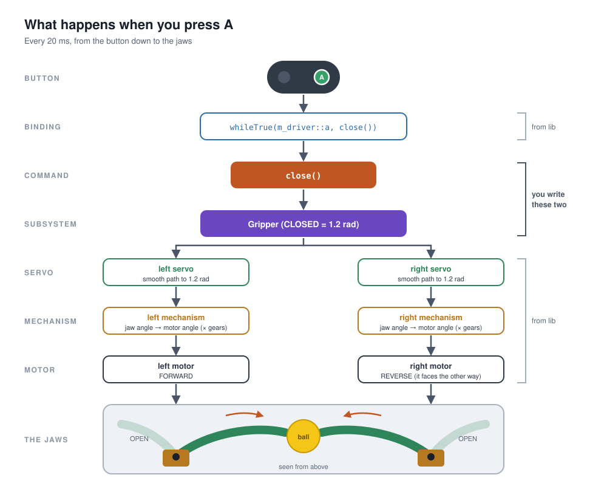
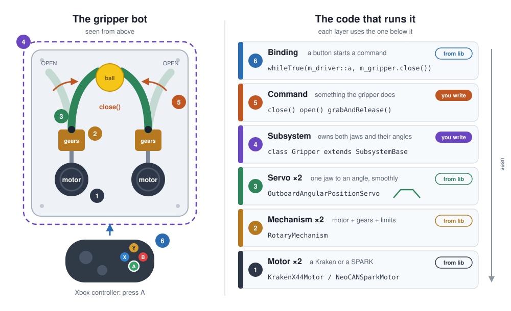

# [Optional] Commands: build a gripper the Team 100 way

In [Control a motor from code](../part1/08_MOTOR_CODE.md#step-12-build-a-grabber)
you built a grabber from scratch: raw motor calls, and `if()`s in
`teleopPeriodic()`. That's the best way to *learn* what happens each
cycle.

The team's robot code doesn't work like that. It builds mechanisms
from pieces that already exist in **`lib`**, and drives them with
**commands**. Most of the job of writing robot code is knowing what's
already there and putting it together.

In this chapter you'll write your **own** subsystem and your **own**
commands for a two-motor **gripper**, built from `lib`'s **building
blocks**: motors, mechanisms, servos, profiles, and button bindings.
Two rules:

* **Use `lib`'s building blocks**, not raw WPILib or raw motor calls,
  when `lib` has a way to do it.
* **Write the subsystem and commands yourself.** `lib` also has some
  ready-made subsystems. Read them to learn the patterns, but don't put
  them in your code.

## The layers

Team 100 code is built in **layers**. Each layer uses the one below it,
and adds one idea. The picture shows what happens when you press **A**:
it goes down through every layer, 50 times a second, until the jaws
move.

* **Binding**: connects a button to a command, once, at startup.
* **Command**: something the gripper **does**: close, open, grab and
  release. Team 100 commands normally **never end** by themselves:
  "close" means "close, and keep holding".
* **Subsystem**: **owns** both jaws, and knows OPEN and CLOSED. Only
  **one command** can use it at a time: a new one **interrupts** the
  old one, so two buttons can never fight over the jaws.
* **Servo** (one per jaw): moves the jaw to an angle **smoothly**, and
  says when it's there.
* **Mechanism** (one per jaw): the motor plus its gears and limits. It
  works in **jaw** angles, not motor angles, and won't drive past fully
  open or closed.
* **Motor** (one per jaw): a Kraken or a SPARK. *(You know this one
  from 1.8.)* The two face each other, so one runs `REVERSE`.

Here's the same thing matched to the robot. Each numbered badge on the
robot marks the part that layer controls:

The binding, servo, mechanism, and motor come from **`lib`**. You
**write** the middle two: your own `Gripper` subsystem and its
commands.

**Learn more:** the [appendix](#appendix-existing-things-you-can-use)
explains each `lib` piece, with links, and lists
[existing subsystems](#existing-subsystems-to-read-not-to-use) to learn
the patterns from.

This chapter is **optional**, but if you want to work on the real robot
code, do it: everything there is built this way.

You need:

* [1.8, Steps 9 to 12](../part1/08_MOTOR_CODE.md#step-9-where-is-the-shaft)
  (position control and the grabber)
* a **new study** with `lib` included, like
  [Your first study](../part1/07_STUDY.md)

Kraken or REV motors both work; use whichever the gripper bot has.

## Safety first

A gripper is a **pinch point**: it's built to close on things, and it
can't tell a ball from a finger.

* Keep the current limit **low** (10 amps) while you're testing.
* Hands **out** of the jaws before you say "Enabling!".
* One person drives; everyone else watches the jaws, not the laptop.

## The gripper bot

> **TODO (mentors):** which bot this is, a photo, the two motors' types
> and CAN IDs, and the gear ratio from motor to jaw.
> 📷 **TODO photo:** `docs/img/gripper_bot.jpg`: the gripper bot, open
> and closed, with the two motors labeled.

| Motor | Kind | CAN ID |
| --- | --- | --- |
| Left jaw | TODO | TODO |
| Right jaw | TODO | TODO |

Gear ratio (motor turns per jaw turn): **TODO**

## Step 1: Your `Gripper` subsystem

**Goal:** your own class `Gripper` that extends `SubsystemBase`, built
from `lib`'s **building blocks** (no `lib` subsystems inside it):

* two motors (your kind: Kraken or REV)
* a `RotaryMechanism` for each, with the **gear ratio**, and a **min
  and max** angle so it can't drive past fully open or fully closed
* an `OutboardAngularPositionServo` for each, sharing one profile
* `OPEN` and `CLOSED` angles as constants, **inside** `Gripper`

`Robot` creates one `Gripper` and has **no motor fields**.

Not sure what one of these is? Each has a short explanation and a
link in the [appendix](#appendix-existing-things-you-can-use).

**Checkpoint:** it builds, and the motors' "created" logs appear in
Glass under your gripper's name.

> **Check yourself:** `DualAngularSubsystem` is already two motors going
> to the same angle. List what a real gripper needs that it doesn't
> have (think: names, limits, motor types, closing on a ball). That
> list is why you're writing your own.

> **Check yourself:** what should the min and max angles be, compared
> with OPEN and CLOSED? A little wider, exactly the same, or narrower?
> What goes wrong with each?

Hint 1: which pieces, in which order?

Bottom to top: motor → `RotaryMechanism` → `OutboardAngularPositionServo`.
`OutboardRotaryPositionSubsystem` does this for one motor, in a
`mech(...)` method; you do it twice. `DualAngularSubsystem` shows how
to name the two sets of logs (`log.name("1")`, `log.name("2")`) so they
don't land on top of each other.

Hint 2: the angles

Angles are **jaw** angles, in radians, because the mechanism knows the
gear ratio. Measure them like in [1.8 Step 9](../part1/08_MOTOR_CODE.md#step-9-where-is-the-shaft):
set the jaws open by hand, start the code (so open is 0), and move a
jaw to closed by hand, watching its logged position. Keep both angles
between −180° and +180°: `setPositionProfiled` takes a **wrapped**
angle (read its comment).

Hint 3: the two motors face each other

Same trick as `DualAngularSubsystem`: one motor `FORWARD`, one
`REVERSE`. Then one target closes both.

## Step 2: `open()` and `close()` commands

**Goal:** `Gripper` has `open()` and `close()`, each **returning a
`Command`**, in the Team 100 style: it moves there and then **keeps
holding**, and never ends by itself. Also give `Gripper` an
`atGoal()` that's true when **both** jaws are there.

**Checkpoint:** it builds. (Nothing moves yet: nobody runs the
commands.)

> **Check yourself:** why does `close()` **return** a command instead
> of closing the gripper right away?

Hint 1

Copy the **shape** of `DualAngularSubsystem.position()`: `startRun`
with "reset both servos" as the start, and "set both to this angle,
profiled" as the run. Then `close()` is that, with `CLOSED`.

## Step 3: Bind the buttons

**Goal:** A closes, B opens, and there's a default command, all set up
**once** in `Robot`'s constructor with `TriggerUtil`.
`teleopPeriodic()` is **empty**.

Decide the default first: when nothing is pressed, should the gripper
**open**, **hold where it is**, or **stop pushing**? Think about the
robot carrying a ball. Write your choice and why in a comment.

**Checkpoint:** A and B work, and enabling without touching anything
does what you chose.

Now try both kinds of binding, and write down what happens when you
**let go** of the button:

* `whileTrue(m_driver::a, m_gripper.close())`
* `onTrue(m_driver::a, m_gripper.close())`

> **Check yourself:** with `onTrue`, `close` never ends. So how does
> pressing B stop it? (See **Subsystem** in [the layers](#the-layers).)

Hint 1

`OutboardRotaryPositionSubsystemSetup` is almost exactly this, with
one button. You need `import static org.team100.lib.util.TriggerUtil.whileTrue;`
(or `onTrue`) at the top, like it has.

## Step 4: Grab and release

**Goal:** **X** does "close, wait 2 seconds, open", by itself. Build it
from your `close()` and `open()`, the way `SimpleSequence` does, with
**no new fields**.

Build it and press X. It probably gets **stuck** closed. Before you
open the hints, work out why.

**Checkpoint:** X grabs, waits, and releases. Then try:

1. Press X, then **B** in the middle.
1. Press X, then **A** in the middle.
1. Press X twice, quickly.

Write down what happens. Did you write any code to handle those?

Hint 1: why it gets stuck

A sequence starts the next step only when the current one **ends**.
Team 100 commands never end by themselves. Which one is stuck?

Hint 2: making it end

`SimpleSequence` uses `.until(rotary::isDone)`. You have `atGoal()`.
But careful: if the gripper closes on a **ball**, it never reaches
CLOSED, so `atGoal()` is never true. `SimpleSequence` also uses
`.withTimeout(...)`. Which is safer here? Could you use both?

Hint 3: where does the sequence go?

`SimpleSequence` puts its sequence in its own little class, to keep
`Robot` tidy. You could do that, or give `Gripper` a
`grabAndRelease()` method. Which is better, if auton will need it too?

## Step 5: Compare

Fill in this table, from your 1.8 grabber and your new gripper:

| | 1.8 grabber (`if()`) | 2.4 gripper (`lib` + commands) |
| --- | --- | --- |
| Lines in `teleopPeriodic()` | | |
| Code you wrote to keep two buttons from fighting | | |
| What happens if it's told to go past fully open | | |
| Moves smoothly, or jumps? | | |
| Could auton reuse "grab and release"? | | |
| How much of it did you write, and how much came from `lib`? | | |

**Checkpoint:** post your table to `#rookie_training`, with one
sentence: **what would you look for in `lib` first, next time you build
a mechanism?**

## Send it in

Commit, push, and open a PR ([how](../part1/02_FORK_WORKFLOW.md)).
Include your Step 5 table. Ask a
mentor to compare your `Gripper` with `IntakeExtend`: what's the same,
and what's different?

> If a class or method named here has moved or changed in `lib`, the
> library has moved on. Find where it went, and fix this page.

## Appendix: existing things you can use

Everything here is in `lib` on the `main` branch. You'll **use** the
motor, mechanism, servo, and binding pieces, and **write** the
subsystem and commands yourself.

### Motor: the one you know

| Class | What it does |
| --- | --- |
| [`KrakenX44Motor`](https://github.com/Team100/all26/blob/main/lib/src/main/java/org/team100/lib/motor/ctre/KrakenX44Motor.java), [`KrakenX60Motor`](https://github.com/Team100/all26/blob/main/lib/src/main/java/org/team100/lib/motor/ctre/KrakenX60Motor.java) | A Kraken, same as in [1.8 Step 3](../part1/08_MOTOR_CODE.md#step-3-create-the-motor). |
| [`NeoCANSparkMotor`](https://github.com/Team100/all26/blob/main/lib/src/main/java/org/team100/lib/motor/rev/NeoCANSparkMotor.java) and the rest of the `rev` folder | A REV motor on a SPARK. Same arguments, plus two at the end. |

### Mechanism: a motor attached to something

| Class | What it does |
| --- | --- |
| [`RotaryMechanism`](https://github.com/Team100/all26/blob/main/lib/src/main/java/org/team100/lib/mechanism/RotaryMechanism.java) | A motor, its encoder, and the **gear ratio** to the thing that turns. It works in **jaw** angles, not motor angles, so you never divide by the gear ratio yourself. It also has a **min and max angle**: it refuses to drive past them, like a fence. |

### Servo: go to an angle, smoothly

| Class | What it does |
| --- | --- |
| [`OutboardAngularPositionServo`](https://github.com/Team100/all26/blob/main/lib/src/main/java/org/team100/lib/servo/OutboardAngularPositionServo.java) | Wraps a mechanism. `setPositionProfiled(angle)` moves it there **smoothly** (speeds up, cruises, slows down) using the motor's built-in feedback. `atGoal()` says whether it got there. `reset()` starts fresh from wherever it is now. ("Outboard" means the feedback runs in the motor controller, which is what we use whenever we can.) Read the [`servo` README](https://github.com/Team100/all26/blob/main/lib/src/main/java/org/team100/lib/servo/README.md) and the comments in [`AngularPositionServo`](https://github.com/Team100/all26/blob/main/lib/src/main/java/org/team100/lib/servo/AngularPositionServo.java). |
| [`TrapezoidProfileR1`](https://github.com/Team100/all26/blob/main/lib/src/main/java/org/team100/lib/profile/r1/TrapezoidProfileR1.java) | The "smoothly" part: a **profile** with a top speed and a top acceleration. Plotted, the speed looks like a trapezoid: up, flat, down. |
| [`ProfileReferenceR1`](https://github.com/Team100/all26/blob/main/lib/src/main/java/org/team100/lib/reference/r1/ProfileReferenceR1.java) | Walks through the profile one cycle at a time and hands the servo each next step. You create it and pass it in; the servo does the rest. |
| [`RDynamicsAnalytic`](https://github.com/Team100/all26/blob/main/lib/src/main/java/org/team100/lib/dynamics/r/RDynamicsAnalytic.java) | A physics model of what's being turned (mass, length), so the servo can add a little extra push to accelerate it. For a light jaw, `RDynamicsAnalytic.thinRod(mass, length)` is close enough. |

### Subsystem and commands: what the gripper can do

| Thing | What it does |
| --- | --- |
| **Subsystem** | A class that **owns** hardware. Every `lib` subsystem extends WPILib's `SubsystemBase`, and so will yours. Only **one command** can use a subsystem at a time: starting a new one **interrupts** the old one, so two buttons can never fight over the jaws. |
| **Command** | Something a subsystem **does**. Inside your subsystem, `run(...)`, `startRun(...)`, and `runOnce(...)` (from `SubsystemBase`) make one for you, and mark it as using this subsystem. Look at how the examples below use them. |
| **Default command** | What a subsystem does when no other command is using it. `setDefaultCommand(...)`. |
| [The `commands` README](https://github.com/Team100/all26/blob/main/lib/src/main/java/org/team100/lib/commands/README.md) | **The Team 100 style:** commands normally **never end** by themselves. "Close" means "close, and keep holding closed", until another command takes over. When a sequence needs to move on, you add the ending yourself: `.until(...)`. |
| The `CommandScheduler` | Runs every command, every cycle. You already call it in `robotPeriodic()` ([1.8 Step 2](../part1/08_MOTOR_CODE.md#step-2-keep-the-library-ticking)). |

### Bindings: connect buttons to commands

| Class | What it does |
| --- | --- |
| [`DriverXboxControl`](https://github.com/Team100/all26/blob/main/lib/src/main/java/org/team100/lib/hid/DriverXboxControl.java) | The controller, same as in 1.8. `a()`, `b()`, `x()` and so on. |
| [`TriggerUtil`](https://github.com/Team100/all26/blob/main/lib/src/main/java/org/team100/lib/util/TriggerUtil.java) | `whileTrue(m_driver::a, command)`: run the command **while** A is held, then stop it. `onTrue(...)`: **start** it when A is pressed, and let it keep going. This is how the team binds buttons; use it, not `new Trigger(...)`. |

### Existing subsystems to read (not to use)

These are ready-made subsystems and setups that put the pieces
together. **Don't use them in your code**; you're writing your own.
Read them for the **pattern**: each is a little different from your
gripper.

| Example | Read it for | What's different from your gripper |
| --- | --- | --- |
| [`DualAngularSubsystem`](https://github.com/Team100/all26/blob/main/lib/src/main/java/org/team100/lib/subsystems/r1/DualAngularSubsystem.java) | **Two motors** driven together: two mechanisms, two servos, one target. Private methods that do the same thing to both. `position()` calls `reset()` first, using `startRun`. | It only knows Kraken X44s, and it has no named positions. |
| [`OutboardRotaryPositionSubsystem`](https://github.com/Team100/all26/blob/main/lib/src/main/java/org/team100/lib/examples/motion/OutboardRotaryPositionSubsystem.java) | **Named positions** (`HOME`, `EXTEND`) as constants. Building the profile, reference, and mechanism step by step, with comments on every number. Uses a **NEO** (REV). | One motor. |
| [`OutboardRotaryPositionSubsystemSetup`](https://github.com/Team100/all26/blob/main/lib/src/main/java/org/team100/lib/examples/motion/OutboardRotaryPositionSubsystemSetup.java) | What goes in `Robot`: create the subsystem, set a default command, bind a button with `whileTrue`. | |
| [`SimpleSequence`](https://github.com/Team100/all26/blob/main/lib/src/main/java/org/team100/lib/examples/motion/SimpleSequence.java) | **"Do this, then that"**: `sequence(...)`, with `.until(...isDone)` and `.withTimeout(2)` to make never-ending commands end. | |
| [`IntakeExtend`](https://github.com/Team100/all26/blob/main/lib/src/main/java/org/team100/frc2026/subsystems/IntakeExtend.java) | A **real competition** subsystem with two motors and two positions, like yours. Notice the pair `goToExtendedPosition()` (ends when it gets there) and `goToExtendedPositionEndlessly()` (never ends). | It's for this year's robot, so it has extra parts you don't need. |

**Check yourself** (good to talk over with your group):

1. In `DualAngularSubsystem`, what makes the two motors move
   **together**? What makes them turn in **opposite** directions?
1. Why does `DualAngularSubsystem.position()` call `reset()` before it
   starts moving? (The comment on `reset()` in `AngularPositionServo`
   says why, in capital letters.)
1. In `OutboardRotaryPositionSubsystem`, which numbers would you change
   for a gripper jaw?
1. `extend()` never ends. So how does `SimpleSequence` move on to the
   next step?

Next: [Part 3: Where am I? (localization)](../part3/01_LOCALIZATION.md)
