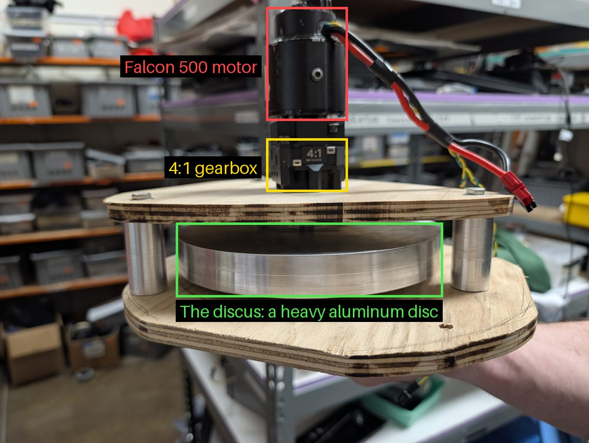
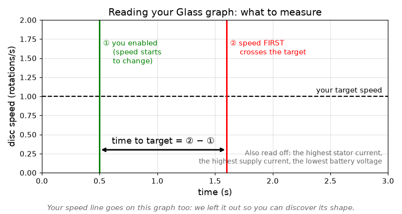
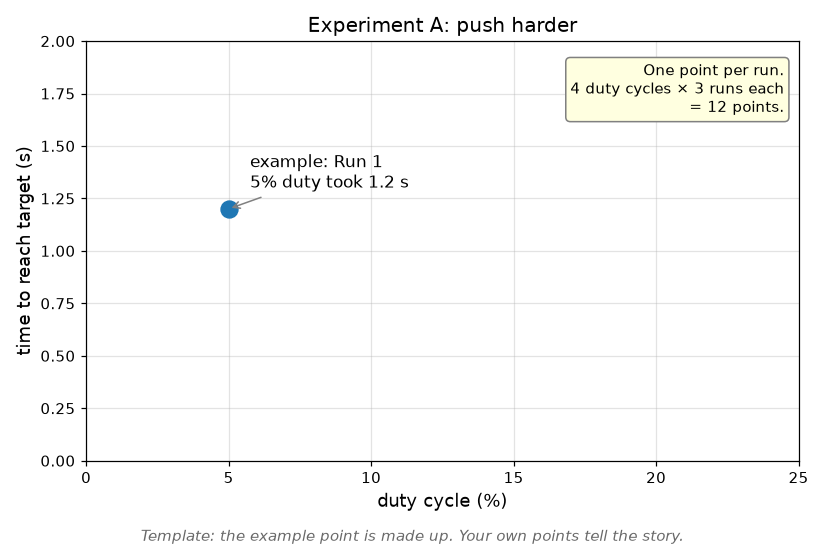
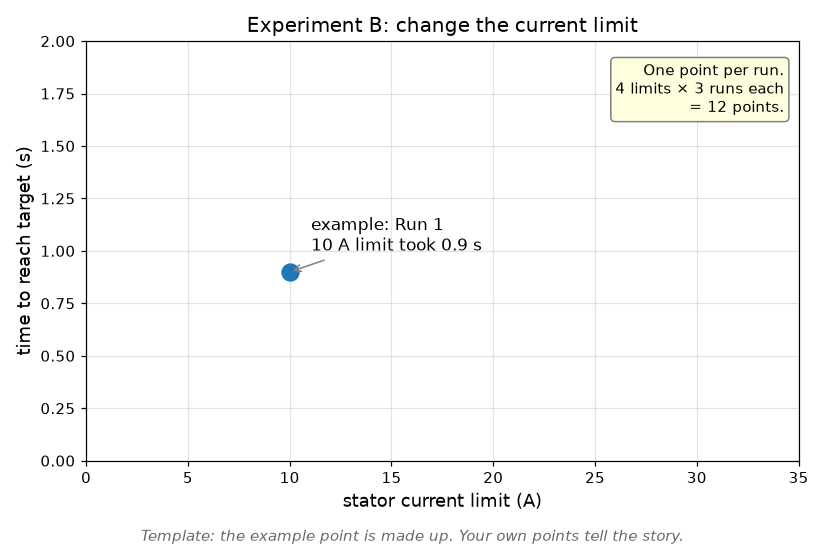
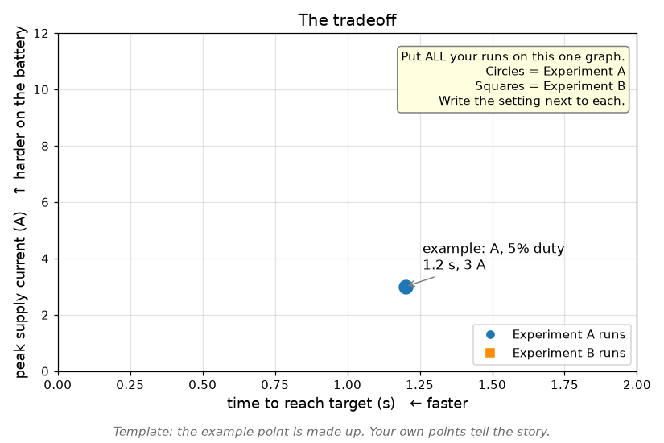
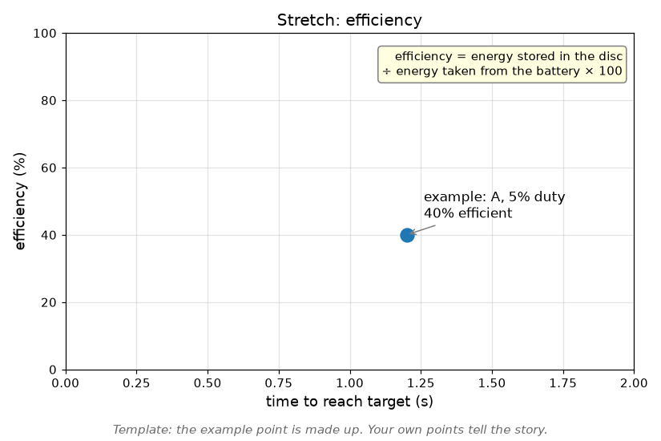

# Easy mode: the Discus

The **Discus** is a heavy aluminum disc spun by one motor. It's the
simplest "real" mechanism we have, and it's great for learning
controls: it has real weight (so it takes effort to speed up and slow
down), but it can't drive away or throw anything.

In this chapter you'll write **your own study** that controls it, step
by step: first just spinning it, then measuring it, then making it hold
a speed by itself. Nobody hands you the code. Each step has a goal, a
checkpoint, and hints if you're stuck, just like
[Control a motor from code](../part1/07_MOTOR_CODE.md).

| Part | What it is |
| --- | --- |
| Motor | **Falcon 500** |
| Gearbox | **4:1**: the motor turns 4 times for each turn of the disc |
| Disc | Heavy aluminum, so it has a lot of **inertia** (resistance to speeding up or slowing down) |
| Controller | RoboRIO |

> [!WARNING]
> **The disc is heavy and can spin fast.** Clamp the Discus to the
> table. Keep hands, hair, and loose sleeves away from it while the
> robot is enabled. One person keeps a finger on **Enter** (disable).

> **Connecting:** plug a **USB-B cable** straight from your laptop into
> the robot's RoboRIO, just like the test board in
> [Deploy](../part1/04_DEPLOY.md). No radios needed: those come in
> [Part 5](../part5/18_ROBOT_NETWORK.md), on the real robot.

## Step 1: Find the motor

**Goal:** you know the Discus motor's CAN ID, and its firmware is ready
for our code.

Use Phoenix Tuner X, exactly like in [Your first motor](../part1/05_FIRST_MOTOR.md).

**Checkpoint:** the CAN ID is written on masking tape on the motor.

Hint

A Falcon 500 is a CTRE motor, so Tuner X can see it. Check its card for
**Phoenix 5** vs. **Phoenix 6** firmware: our code needs Phoenix 6.

## Step 2: Your Discus study

**Goal:** a new study, with `lib` included, that creates the Discus
motor. Use a **low current limit** to start.

You've done this before: [Your first study](../part1/06_STUDY.md), then
Step 3 of [Control a motor from code](../part1/07_MOTOR_CODE.md#step-3-create-the-motor).

**Checkpoint:** it builds, deploys, and prints your "motor created"
messages.

Hint

Which motor class represents a **Falcon 500**? Look in `lib`'s motor
folder, in the `ctre` part.

## Step 3: Spin it with the stick

**Goal:** the left stick controls the disc's duty cycle, capped at
**20%**.

**Checkpoint:** the disc follows the stick, gently, both directions.

> **Check yourself:** the disc keeps spinning for a while after you let
> go of the stick. Why? What does `NeutralMode100` have to do with it?
> Try changing it.

## Step 4: Measure it

**Goal:** you can see, in [Glass](09_GLASS_POWER.md#make-a-graph), a graph
of the disc's **speed**, **stator current**, and **supply current**
while you drive it with the stick.

Then work out the **disc's** speed, not just the motor's. Remember the
4:1 gearbox.

**Checkpoint:** a screenshot of your graph in Slack, and the disc's top
speed in **rotations per second**.

> **Check yourself:**
> 1. Push the stick to 20% and hold it. The disc speeds up, then levels
>    off. Why does it stop speeding up? (Think back-EMF, from
>    [How motors work](../part1/05a_HOW_MOTORS_WORK.md#why-it-doesnt-melt-every-time-back-emf).)
> 2. Look at the current graph. When is the current biggest: while
>    speeding up, or at a steady speed? Why?

Hint

Your motor already logs its speed and currents. Find them in Glass
under `log`. If you also print the speed, divide by the gear ratio to
get the disc's speed.

## Step 5: The mystery graph

Now use what you learned in the [rag test](09_GLASS_POWER.md#your-first-power-draw-test-the-rag-test)
on a real mechanism. One of you makes things happen to the Discus; the
other has to work out **what happened, and when, just by looking at
the graph**.

**Work in pairs** (a mechanical teammate is a great partner for this):

1. **Both:** in Glass, graph the disc's speed, **stator current**,
   **supply current**, and the battery voltage. Make the plot show about
   the **last 30 seconds**.
   > **TODO:** add where Glass's plot time-window setting is.
1. **Person A (the driver)** writes down a secret plan of 4 to 6 events,
   for example: "spin up to 15%, hold, slow down, reverse, stop,
   coast". Then does them, about 5 seconds each, and writes down the
   order. **Person B** looks away from the Discus.
1. **Person A** takes a screenshot of the graph right away, and gives
   it to Person B.
1. **Person B** annotates the screenshot: mark **when** each thing
   happened and **what** it was, using only the graph. Explain how you
   could tell ("the stator current jumped and the speed fell, so it
   slowed down here").
1. Compare with Person A's secret plan. Then swap.

**Checkpoint:** post the annotated graph to **`#rookie_training`** as
proof, with how many events Person B got right.

> **Check yourself:** which events were easy to spot, and which were
> hard? Which line on the graph gave each one away?

## Step 6: Speed vs. power

How **fast** can you spin the disc up? And what does that **cost** in
current? Real robots face this all the time: a shooter that spins up
faster draws more from the battery.

> [!WARNING]
> A mentor picks the **highest current limit** you may use. Keep the
> Discus clamped.

### Get ready

1. Pick a **target speed** that even 5% duty can reach (look at your
   Step 4 results). About **1 rotation per second** of the disc is a
   good start.
1. Change your study so a button starts the disc **from a stop** at a
   set duty cycle. Every run must start from a stop.
1. In Glass, graph: disc speed, stator current, supply current, battery
   voltage.

### How to measure one run

For every run, write down: **time to target**, **highest stator
current**, **highest supply current**, **lowest battery voltage**.

### Experiment A: push harder

Keep the current limit the same (your mentor's number). Change only the
**duty cycle**: 5%, 10%, 15%, 20%. Do each one **3 times**.

Make this graph, one point per run:

### Experiment B: change the current limit

Keep the duty cycle at **20%**. Change only the **stator current
limit**: 5, 10, 20, 30 A (or your mentor's numbers). Do each one
**3 times**.

Make this graph, one point per run:

> **Look closely:** in Experiment B, what **shape** is the speed line in
> Glass while the disc speeds up? Is it the same shape as in
> Experiment A? Why might that be?

### Put it together: the tradeoff

Put **every** run from A and B on one graph:

> **Check yourself:**
> 1. Which runs are fast **and** easy on the battery?
> 2. Is there a point where a lot more current only makes it a little
>    faster?
> 3. Which knob gave you more control: duty cycle or current limit?

### Design challenge

Your mentor gives you a budget, like: *"reach the target in under
**X** seconds, and never go over **Y** amps of supply current."* Pick a
duty cycle and current limit that meet it, and **prove it** with a
graph.

**Checkpoint:** post your three graphs and your design-challenge proof
to **`#rookie_training`**.

⭐ Stretch: energy and efficiency

How much of the battery's energy actually ends up in the spinning disc?

* **Energy from the battery** (in joules): every 20 ms, add up
  `battery voltage × supply current × 0.02`, from enable until the disc
  reaches the target.
* **Energy stored in the disc:** `½ × I × ω²`, where `ω` is the disc's
  speed in radians per second (`rotations/s × 2π`), and `I = ½ × mass ×
  radius²` (in kg and meters). Weigh and measure the disc!
* **Efficiency** = stored ÷ from the battery × 100.

Where did the rest of the energy go? (Think about
[heat](../part1/05a_HOW_MOTORS_WORK.md#heat), friction, and the
gearbox.) Are the fastest runs the most efficient, or the least?

## Step 7: Hold a speed by itself (feedback)

So far *you* control the power. Now make the code **hold a target
speed**, even if you slow the disc down by hand (gently, with a rag).

**Goal:** when you hold the **A** button, the disc spins up to **1
rotation per second** and stays there.

The idea is called **feedback**: every cycle, compare the speed you
**want** to the speed you **have**. The difference is the **error**.
Then set the power based on the error: big error, more power.

**Checkpoint:** a Glass graph showing the target speed and the actual
speed, getting close to each other.

Hint 1

`error = target − measured`. Then `power = k × error`, where `k` is a
small number you choose. Start very small.

Hint 2

Try a few values of `k`. Too small: the disc never quite gets there.
Too big: it overshoots and wobbles back and forth. What happens in
between?

> **Check yourself:** with only feedback, the disc always ends up a bit
> **slower** than the target. Why? (What would make `error` exactly
> zero, and what would the power be then?)

## Step 8 (stretch): Help it with a guess (feedforward)

Feedback only reacts *after* there's an error. **Feedforward** is a
guess at how much power a speed needs, sent **before** anything goes
wrong.

**Goal:** measure what duty cycle gives each speed (from Step 4), and
use that as your starting guess. Then add your feedback on top.

**Checkpoint:** with feedforward plus feedback, the disc reaches the
target faster and closer than with feedback alone. Show both graphs.

## Send it in

Commit your study, push, and open a PR with your graphs and your
answers to the check-yourself questions.

Next: [Hard mode: the shooter bot](11_DEMO_BOT.md)
