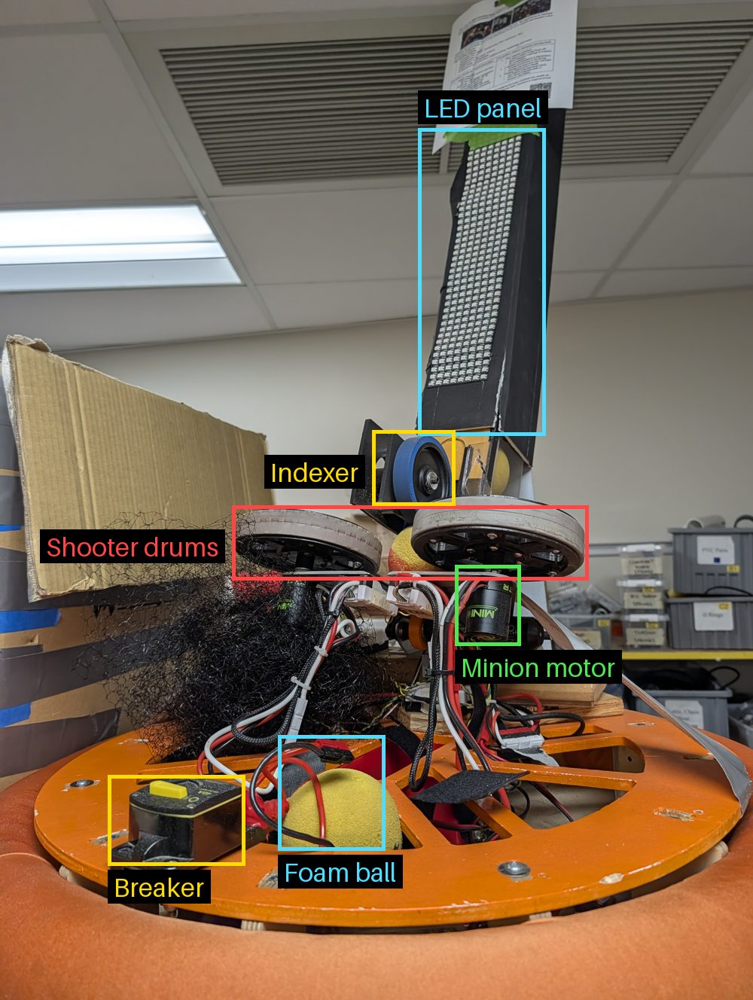

# Hard mode: the shooter bot

The **demo bot** is a whole robot that **shoots foam balls**. In this
chapter you'll write **your own study** that makes the shooter work:
spin up the shooter drums, wait until they're fast enough, then feed in
one ball at a time.

You've got everything you need from Part 1 and the Discus. This time
there are more motors, a new kind of motor controller, and real safety
limits.

| Part | What it does |
| --- | --- |
| **Shooter drums** | Two wheels spinning in opposite directions. The ball is squeezed between them and flung out |
| **Indexer** | A wheel that pushes one ball at a time into the drums |
| **Motors** | Small brushless motors on **REV SPARK** controllers (not Krakens) |

## Safety first

> [!CAUTION]
> **This robot shoots balls at face height.** Before anyone enables it:
>
> * Everyone nearby wears **safety glasses**.
> * Nobody stands in front of the shooter. Point it at a net or a wall.
> * One person keeps a finger on **Enter** (disable), and says
>   **"Enabling!"** before enabling.
> * **Shooter power is capped at 20% (duty cycle 0.2).** Your code must
>   never send the shooter more than that. Raising it needs a mentor.

Why a cap? A ball's danger to an eye depends on its **speed**. Our team
rule is a top speed of about **20 m/s**, because faster than that, a
foam ball carries enough energy to injure an eye. Keeping the shooter at
low power keeps the ball well under that.

> **Connecting:** plug a **USB-B cable** straight from your laptop into
> the demo bot's RoboRIO, just like the test board in
> [Deploy](../part1/04_DEPLOY.md). No radios needed: those come in
> [Part 5](../part5/22_ROBOT_NETWORK.md), on the real robot.

Keep the robot **on blocks** (wheels off the floor) while it's tethered:
you're testing the shooter, not driving.

## Step 1: Find the motors (REV Hardware Client)

These motors use **REV SPARK** controllers, so **Phoenix Tuner X can't
see them**. Use the **REV Hardware Client** instead.

**Goal:** you know the CAN ID of each **shooter drum** motor and the
**indexer** motor, and each one is written on masking tape.

1. Find the REV Hardware Client on the laptop (Windows key, type "REV").
   If it's not there, download it
   [here](https://docs.revrobotics.com/rev-hardware-client).

   

1. Plug a USB-C cable from the laptop straight into one **SPARK**, and
   click **Refresh**.

   

1. The **CAN Bus** tab should say "Bus OK", and **CAN Data** should
   show messages flowing.

   

1. Write down its CAN ID. To find out which motor this SPARK drives,
   spin it slowly from the client's run tab and watch.

> 📷 **TODO photo:** `docs/img/demo_bot_spark_usb.jpg`: a USB-C cable
> plugged into one of the demo bot's SPARKs.

**Checkpoint:** a table of motor → CAN ID, checked with a mentor.

## Step 2: Your shooter study

**Goal:** a new study, with `lib` included, that creates **both
shooter drum motors** and the **indexer motor**. Low current limits.

**Checkpoint:** it builds, deploys, and prints your "motors created"
messages.

Hint 1: which motor class?

These are REV motors on SPARK controllers, so look in `lib`'s motor
folder, in the `rev` part. Ask a mentor which **motor** each SPARK is
driving, and pick the class that matches it. ("Use the class that
represents your motor" still applies.)

Hint 2: new arguments

The SPARK motor classes need a couple of extra arguments that the
Kraken class didn't. Read their comments. If you're not sure, `0` is a
safe starting value; ask a mentor what they do.

## Step 3: Spin one drum

**Goal:** while you hold the **right bumper**, **one** shooter drum
spins at **10%**. Let go, and it stops.

**Checkpoint:** you know which drum it is, and which way it spins.

## Step 4: Spin both drums the right way

The drums must spin in **opposite directions**, so the ball gets pulled
in between them and flung out (not pushed back at you).

**Goal:** the right bumper spins both drums, in the right directions,
at the same power, never above **0.2**.

**Checkpoint:** a mentor checks both directions **before** any ball
goes near the robot.

Hint

You don't have to send one motor a negative number. One of the
motor's constructor arguments says which way is "forward".

## Step 5: Know when the drums are ready

A ball fed into slow drums just dribbles out. So the robot needs to
**know** when the drums are up to speed.

**Goal:** print (or log) whether the drums are **ready**: both at least
as fast as a target speed you choose.

**Checkpoint:** in [Glass](10_GLASS_POWER.md#make-a-graph), graph both
drum speeds as they spin up. Mark where they cross your target. How long
does spin-up take?

Hint

Measure each drum's speed like you did on the Discus. Pick a target a
bit below the speed they reach at your power, so "ready" happens a
moment before they level off.

## Step 6: Feed one ball

**Goal:** while you hold the **B** button, the drums spin up, and **only
when they're ready**, the indexer turns just long enough to push in
**one** ball. Then it waits for the drums to recover, and feeds the next.

**Checkpoint:** with safety glasses on and the robot aimed at a net,
hold **B** and watch it shoot a few balls, one at a time, all at about
the same distance.

Hint 1: break it into small steps

Write down, in plain words, what should happen in order: spin up →
wait until ready → feed for a short time → stop feeding → wait until
ready again → … Then turn each line into code.

Hint 2: commands

This is exactly what WPILib **commands** are for: small actions you can
put "in sequence", "in parallel", "until something is true", and
"repeatedly". Read
[WPILib: command compositions](https://docs.wpilib.org/en/stable/docs/software/commandbased/command-compositions.html).

> **Check yourself:** what happens to the drums' speed at the moment a
> ball goes through? Look at your Glass graph. Why?

## Step 7: The mystery graph

Same game as on the [Discus](11_DISCUS.md#step-5-the-mystery-graph),
now with the whole shooter. One of you shoots; the other has to work
out **what happened, and when, just by looking at the graphs**.

1. **Both:** in Glass, graph both drum **speeds**, the drums' and the
   indexer's **stator** and **supply** currents, and the battery
   voltage. Make the plot show about the **last 30 seconds**.
1. **Person A** (safety glasses on, aimed at a net) secretly does a
   sequence, and writes it down: for example, spin up, shoot 2 balls,
   wait, shoot 1 more, stop. **Person B** looks away from the robot.
1. **Person A** takes a screenshot of the graph right away, and gives
   it to Person B.
1. **Person B** annotates it: mark when the drums **started** spinning
   up, when they were **ready**, every moment a **ball went through**,
   and when it **stopped**. Explain what gave each one away.
1. Compare with Person A's list. Then swap.

**Checkpoint:** post the annotated graph to **`#rookie_training`** as
proof, with how many events Person B got right.

> **Check yourself:**
> 1. How could you tell exactly when a ball went through? Which lines
>    moved, and which way?
> 2. Which drew more current: spinning the drums up, or keeping them
>    spinning? Why?
> 3. How long did the drums take to recover after each ball? Could you
>    shoot faster?

## Make it better

Pick one, plan it with a mentor, and send it in as a PR. Each one will
help you in the challenge below.

* Make the LEDs show when the shooter is **ready**.
* Add a button that **stops everything** at once.
* Make the shooter more consistent: does a little **feedback** (from the
  Discus) help the drums recover faster after each ball?

## 🏆 The Shooter Challenge

Get as many balls as possible into a bucket, as fast as possible.

### Setup: just a tape measure

No cameras, no fancy tools. On purpose.

1. Put a **bucket** at the challenge distance from the front of the
   robot, measured with a tape measure. Start at **10 m**, and the
   mentor moves it closer if the shooter can't reach.
   > **TODO (mentors):** set the real distance after the first runs,
   > and write it here.
1. Put a **net or wall behind the bucket**, and mark the robot's spot on
   the floor with tape, so every team starts from the same place.
1. Aim by eye. You may turn the robot by hand before the run, but not
   during it.
1. Load **5 balls**.

> [!CAUTION]
> Safety glasses for everyone. **Nobody downrange**, including whoever
> watches the bucket: stand to the side. The **0.2 power cap** stays:
> if you can't reach the bucket, the bucket moves, not the cap.

### Scoring

* **Your code** times the run (from pressing the button to the 5th ball
  leaving the robot) and counts the balls it fed. Print both at the end.
* **A human** counts how many balls landed **in the bucket** (and stayed
  in).

> **Score = balls in the bucket ÷ seconds**

That's **makes per second**. It rewards both accuracy *and* speed:

* `balls in ÷ balls shot` = your **accuracy**
* `balls shot ÷ seconds` = your **speed**
* score = accuracy × speed

All 5 balls must be shot for the run to count. Ties go to the more
accurate run.

**Example:** 3 balls in, in 6 seconds: score **0.5**. 4 balls in, in 10
seconds: score **0.4**. The first run wins, even with fewer balls in.

> **Check yourself:** if you shoot as fast as possible and only 1 goes
> in, in 3 seconds, what's your score? What if you shoot slowly and
> carefully: 5 in, in 20 seconds? What's the best strategy?

Practice as much as you like. For an **official** run, a mentor watches;
you get **3 tries**, and your best one counts. Post your score, the
printed time, and a video to **`#rookie_training`**.

### Records

Beat a record at a distance? Post the proof, then update this table
with a pull request.

| Distance | Score | Balls in | Seconds | Who | Date | Slack proof |
| --- | --- | --- | --- | --- | --- | --- |
| 10 m | — | | | | | |

### After the challenge: what did you have to guess?

Write down every guess you made: the bucket's exact distance, where the
robot was pointing, the right drum speed, how each ball would fly.

> **Check yourself:**
> 1. If someone moved the bucket half a meter while you weren't
>    looking, would your robot know? How could it find out?
> 2. What if a robot could **see** the bucket and measure the distance
>    itself? What would it need to know about its own camera to get the
>    distance right?

Keep your list. In [Part 3](../part3/15_VISION.md), robots use cameras to
measure where things are, and you'll see why a camera has to be
**calibrated** before its measurements can be trusted.

Next: [Part 3: SSH into the RoboRIO and the Pis](../part3/13_SSH_AND_CHECKS.md)
