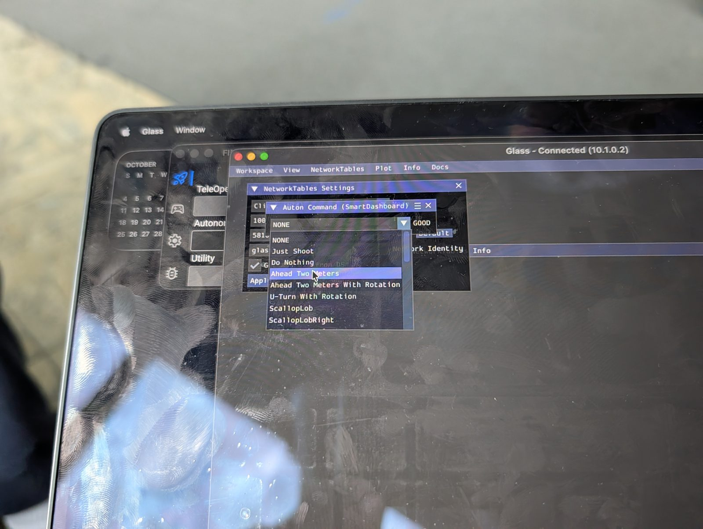

# Work on auton

In this chapter you'll write your first autonomous routine ("auton"):
**drive forward 2 meters, then drive back to where you started.** You'll
test it in the simulator first, then on a real robot.

Along the way you'll learn the words everyone uses when talking about
robot motion: **pose**, **transform**, **heading**, **course**,
**waypoint**, **trajectory**, and **controller**.

Before you start, you should have finished
[Setup](../part1/01_SETUP.md), [Fork workflow](../part1/02_FORK_WORKFLOW.md), the
[simulator chapter](../part1/09_SIMULATOR.md), and
[Where am I? (localization)](01_LOCALIZATION.md). This chapter uses the
`main` branch and a RoboRIO robot.

## Part 1: The ideas

### Pose: where am I?

A **pose** is where the robot is *and* which way it's facing. In WPILib
it's a [`Pose2d`](https://docs.wpilib.org/en/stable/docs/software/advanced-controls/geometry/pose.html):

```java
Pose2d p = new Pose2d(4.0, 2.5, Rotation2d.kZero);
//                    x    y    heading
```

* **x, y** are in **meters**, measured on the field.
* **heading** is the way the front of the robot points, as a
  `Rotation2d`. Angles are in **radians** and counterclockwise is
  positive. `Rotation2d.kZero` faces +x; `Rotation2d.kPi` faces −x.

Where is (0, 0)? WPILib puts the origin in a corner of the field, with
+x pointing away from the blue driver station and +y to the left. Read
the [WPILib coordinate system page](https://docs.wpilib.org/en/stable/docs/software/basic-programming/coordinate-system.html)
and find the picture.

> **Check yourself:** a robot at `new Pose2d(4, 2.5, Rotation2d.kPi)`
> drives "forward". Does x get bigger or smaller?

Our competition code keeps track of the robot's current pose using
wheel odometry (as in [Where am I?](01_LOCALIZATION.md)), the gyro,
and AprilTags seen by the Pi cameras (you'll get to those in
[Part 5](../part5/03_VISION.md)). You get it with
`machinery.m_drive.getState().pose()`.

### Transform: move relative to me

A **transform** (`Transform2d`) is a move described *from the robot's
point of view*: "2 meters ahead, 0 to the left, no turn."

```java
Transform2d twoAhead = new Transform2d(2, 0, Rotation2d.kZero);
Pose2d there = here.plus(twoAhead);
```

`here.plus(twoAhead)` gives the pose 2 m in front of the robot,
**whichever way it's facing**. This is how you write an auton that works
from any starting spot.

> **Check yourself:** if `here` is facing −x (`Rotation2d.kPi`), what is
> `there.getX()` compared to `here.getX()`?

### Heading vs course

Our robots use swerve drive, which means they can drive in one direction
while facing another.

* **Heading:** which way the robot *faces*. This is part of the pose.
* **Course:** which way the robot *travels*.

When you drive forward, heading and course are the same. When you drive
*backward* without turning around, the heading stays the same and the
course points the opposite way. This matters for the return trip.

In our library, a course is a
[`DirectionSE2`](https://github.com/Team100/all26/blob/main/lib/src/main/java/org/team100/lib/geometry/se2/DirectionSE2.java).
The easy one to use is `DirectionSE2.irrotational(angle)`, which means
"travel toward `angle` without spinning."

### Waypoint: a place to pass through

A **waypoint**
([`WaypointSE2`](https://github.com/Team100/all26/blob/main/lib/src/main/java/org/team100/lib/geometry/se2/WaypointSE2.java))
is a pose plus the course the robot should have there, plus a "scale":

```java
new WaypointSE2(pose, course, 1)
```

* `pose`: where to be and which way to face
* `course`: which way to be travelling at that moment
* `scale`: how strongly the course bends the path. Use `1` for now. Bigger
  numbers make wider curves, as in
  [`UTurnWithRotation`](https://github.com/Team100/all26/blob/main/comp/src/main/java/org/team100/frc2026/auton/UTurnWithRotation.java).

### Trajectory: the path plus a schedule

You give the planner a list of waypoints, and it makes a
**trajectory**: a smooth path through them, plus *when* the robot should
be at each point along it, respecting how fast the robot can go and
accelerate.

```java
TrajectorySE2 t = planner.restToRest(waypoints);
```

`restToRest` means the robot is stopped at the start and the end.
Read the [trajectory README](https://github.com/Team100/all26/blob/main/lib/src/main/java/org/team100/lib/trajectory/README.md)
for how it works inside.

### Controller: stay on the trajectory

Wheels slip and batteries sag, so the robot never follows the plan
perfectly. A **controller** compares where the robot *is* to where the
trajectory says it *should be*, and corrects. It is set up for you in
[`Autons.java`](https://github.com/Team100/all26/blob/main/comp/src/main/java/org/team100/frc2026/auton/Autons.java)
(look for `FullStateControllerSE2`). Read the comments on each number.
You don't need to change them yet.

### Commands: doing things in order

Each drive step is a **command**, a thing the robot does until it's
finished. WPILib can chain commands:

```java
command = sequence(stepOne, waitSeconds(1), stepTwo);
```

Read [WPILib command compositions](https://docs.wpilib.org/en/stable/docs/software/commandbased/command-compositions.html).

## Part 2: Read the example

Open
[`comp/.../auton/AheadTwoMeters.java`](https://github.com/Team100/all26/blob/main/comp/src/main/java/org/team100/frc2026/auton/AheadTwoMeters.java).
It already does the first half of your job. Read it slowly and answer
these questions (write the answers down, or tell a mentor):

1. In `t1`, what is `p1`? Where does it come from? (Hint: look at
   `initialize()` in
   [`DriveWithTrajectoryFunction`](https://github.com/Team100/all26/blob/main/lib/src/main/java/org/team100/lib/subsystems/se2/commands/DriveWithTrajectoryFunction.java).)
1. What does `DirectionSE2.irrotational(p1.getRotation())` mean in words?
1. Why is the course the same at both waypoints?
1. What would change if the `Transform2d` were `(0, 2, Rotation2d.kZero)`?
1. What does `n1.until(n1::isDone)` do?
1. The comment says "Note slow constraints here." Find `slow()` in
   `TimingConstraintFactory`. Why is slow a good idea for a training
   auton?

Then look at
[`LeftSequenceExample.java`](https://github.com/Team100/all26/blob/main/comp/src/main/java/org/team100/frc2026/auton/LeftSequenceExample.java),
which runs **two** trajectories in a row. That's the shape you need.

## Part 3: Plan "There and Back"

You need two trajectories:

* **Out:** from the start, 2 m ahead. (You've seen this.)
* **Back:** from wherever you ended up, to **the start pose**.

Think about this before you write code. For the return trip you could
do either of these:

* **(a)** "2 meters behind wherever I am now" (a transform), or
* **(b)** "the exact pose where I started" (a remembered pose).

> **Check yourself:** suppose the robot actually stops 1.95 m out, not
> 2.00 m. Where does (a) leave it? Where does (b) leave it? Which one is
> "back to where it started"?

To do (b), the code has to **remember the start pose** when the out-trip
begins, and use it when the back-trip begins.

And for the course on the way back: the robot is still facing the
same way as before, but it's travelling the opposite way. What angle is
"opposite of the robot's heading"? (Look at how `UTurnWithRotation`
computes `d2`.)

## Part 4: Write it

1. Sync your fork and make a branch, e.g. `alice/there-and-back`
   ([how](../part1/02_FORK_WORKFLOW.md)).
1. Open the `comp` folder in VS Code.
1. In `comp/src/main/java/org/team100/frc2026/auton/`, create
   `ThereAndBack.java`. Start by copying `AheadTwoMeters.java`, and
   rename the class and `name()` (to "There And Back").
1. Change it so that:
   * there's a field to remember the start pose
   * there are two trajectory functions, `out` and `back`
   * `out` remembers its starting pose, then goes 2 m ahead
   * `back` goes from its starting pose to the remembered pose, with the
     reversed course
   * the command runs `out` and then `back` in a `sequence`
   * `trajectoryFns()` returns both, so the dashboard can draw them
1. Register it in `Autons.java`, next to `AheadTwoMeters`.
1. Build (WPILib → **Build Robot Code**). Fix errors until it's
   `BUILD SUCCESSFUL`. Errors in code you didn't touch? See the
   [Build errors FAQ](../reference/BUILD_ERRORS.md).

   > 🖥️ **Advanced:** in a terminal, run `./gradlew build` in the `comp` folder ([how](../part1/01_SETUP.md#advanced-run-commands-from-a-terminal)).

Stuck? Use the hints at the bottom. Try each one before opening the next.

## Part 5: Test in the simulator

1. WPILib → **Simulate Robot Code**, pick `comp`, choose **Sim GUI** only.

   > 🖥️ **Advanced:** in a terminal, run `./gradlew simulateJava` in the `comp` folder ([how](../part1/01_SETUP.md#advanced-run-commands-from-a-terminal)).
1. Open the field view (see the
   [simulator chapter](../part1/09_SIMULATOR.md)).
1. Find the **Auton Command** chooser (`NetworkTables → SmartDashboard →
   Auton Command`) and pick **There And Back**. While the robot is
   disabled, the field should draw both trajectories.
1. Click **Autonomous** in the Robot State widget.

**Checkpoint:** the robot drives 2 m, stops, drives back, and ends up
where it started, facing the same way.

Try these experiments, and predict the result *before* you run each one:

* Drive the robot somewhere else in teleop and turn it, then run the
  auton again. Does it still go "2 m ahead" of where it's facing?
* Add `waitSeconds(1)` between the two steps.
* Change the out-trip to go 2 m to the robot's left instead.

### Make a circle (simulator first)

Straight lines are the easy case. Now write a second auton that drives
a **circle**, and get it right in the simulator **before** it goes
anywhere near a real robot.

**Goal:** a new auton, **Circle**, that drives a circle about **1 m
across** and comes back to where it started, **facing the same way**.
Register it in `Autons.java` like There And Back.

<details>
<summary>Hint: how do I make a circle?</summary>

A trajectory goes through **waypoints**, and each waypoint has a
**course** (the direction of travel there). Put a few waypoints around
the circle, and make each course point along the circle, like a car
driving around a roundabout. Look at how `UTurnWithRotation` makes a
curve.
</details>

<details>
<summary>Hint 2: how many waypoints?</summary>

Start with four: the start, the far side, and the two sides in between,
then back to the start. If the path looks lumpy in the field view, try
more. What changes?
</details>

**Test it in the simulator:**

1. Pick **Circle** in the Auton Command chooser. While disabled, the
   field view draws the path. Does it look like a circle? If not, fix
   it **before** enabling.
1. Run it in **Autonomous**. Watch the robot follow the path.
1. Run it from a different starting spot and heading. Does the circle
   move with the robot, or always go to the same place on the field?
   Why?

**Measure it in the simulator, too.** Write down where the robot
**thinks** it ended up compared to where it started (the field view, or
its pose in Glass). In the simulator, the wheels never slip, so this is
**only** tracking error (the controller), not localization error. Keep
these numbers: you'll compare them with the real robot in Part 7.

**Checkpoint:** the Circle path looks like a circle, the simulated
robot ends within a few centimeters of its start, facing the same way,
and you've written down the simulator's error. **Don't run Circle on a
real robot until this passes.**

> **Check yourself:** the simulated robot does the circle almost
> perfectly. Will the real one? List two things the simulator doesn't
> have that a real robot does.

### Change the speed (simulator first)

In a match, auton is only 20 seconds long, so speed matters. But faster
isn't free: the faster the robot goes, the harder it is to stay on the
path. In this exercise you'll make There and Back faster (and slower),
and **measure** what that costs.

The **path** (the shape) and the **speed** are set in different places.
The waypoints decide the shape. The **timing constraints** decide how
fast the robot goes along it. Look at this line in your
`ThereAndBack.java`:

```java
trajectoryFactory = new TrajectorySE2Factory(new TimingConstraintFactory(kinodynamics).slow());
```

Open
[`TimingConstraintFactory`](https://github.com/Team100/all26/blob/main/lib/src/main/java/org/team100/lib/trajectory/se2/constraint/TimingConstraintFactory.java).
`slow()` is just `scaled(0.25, 0.25, 0.25, 0.25)`: 25% of the robot's
top speed, 25% of its top acceleration, and so on. Read the comment on
`scaled()` to see what each of the four numbers means. There are other
ready-made settings, like `allGood()` and `medium()`.

> **Don't edit `TimingConstraintFactory`.** Every auton shares it, so a
> change there changes all of them. Call `scaled(...)` with your own
> numbers in **your** auton instead. (The comment on `allGood()` says
> the same thing.)

**1. Measure the baseline.** How long does There and Back take now?
A stopwatch works, but the planner already knows: every trajectory has
a `duration()`, in seconds. Print it from inside `out()` and `back()`,
just before you return the trajectory:

```java
TrajectorySE2 t = planner.restToRest(waypoints);
System.out.println("out takes " + t.duration() + " s");
return t;
```

The message shows up in the VS Code terminal where the simulator is
running. Write down the time for each half, and the end error you
measured in the simulator.

**2. Go faster.** Change `slow()` to `scaled(0.5, 0.5, 0.25, 0.25)`
(twice the speed and twice the acceleration).

> **Check yourself:** **before you run it**, predict the new time. Is it
> exactly half? (Hint: on a 2 m drive, does the robot ever reach its top
> speed, or is it speeding up and slowing down the whole time?)

Run it and compare with your prediction. Then try a few more settings,
and fill in a table:

| Setting | Predicted time (s) | Actual time (s) | End error in sim (cm) |
| --- | --- | --- | --- |
| `slow()` | | | |
| `scaled(0.5, 0.5, 0.25, 0.25)` | | | |
| `scaled(0.75, 0.75, 0.25, 0.25)` | | | |
| `scaled(0.1, 0.1, 0.1, 0.1)` (slower!) | | | |

Which number matters most for a 2 m drive: speed or acceleration? Change
only one at a time to find out.

**3. Fast out, slow back.** Make the robot drive out fast and come back
slowly. You'll need a way to give `out` and `back` different
constraints.

<details>
<summary>Hint: different speeds for each half</summary>

The speed lives in the planner, and right now both halves use the same
one. Can you make **two** `TrajectorySE2Factory`s and two
`TrajectorySE2Planner`s, one for each half?
</details>

**4. Speed up the Circle.** Try your faster settings on Circle. A curve
has a constraint a straight line doesn't: the third number,
**centripetal** acceleration (the push that keeps the robot on the
curve). What happens to the time when you raise only that one?

**Checkpoint:** a filled-in table, and one sentence on what makes the
robot slower or faster on a short drive. On the real robot (in
[Part 7](#the-experiments)), go up **in small steps**, with a mentor and
**more clear floor** than before, since a fast robot can overshoot.

## Part 6: Run it on a real robot

Only with a mentor, the first few times.

1. Find **at least 3 meters of clear floor** in front of the robot, and
   a little behind it.
1. Deploy (WPILib → **Deploy Robot Code**).

   > 🖥️ **Advanced:** in a terminal, run `./gradlew deploy` in the `comp` folder ([how](../part1/01_SETUP.md#advanced-run-commands-from-a-terminal)).
1. **Pick the auton in Glass.** The Driver Station can't choose which
   auton runs. If nobody picks one, the robot runs `NONE` and just sits
   there when you enable.
   1. Open Glass: on Windows, `Ctrl+Shift+P` → **WPILib: Start Tool** →
      **Glass**; on a Mac, from `~/wpilib/2026/tools`
      ([how](../part2/01_GLASS_POWER.md#open-glass-and-connect)).
   1. Connect: **NetworkTables Settings** → **Client**, **Team** →
      **100**, **Apply**. (More in
      [Glass](../part2/01_GLASS_POWER.md#open-glass-and-connect).)
   1. Choose: **SmartDashboard** → **Auton Command** → **There And
      Back**.

   

1. In the Driver Station, choose **Autonomous**.
1. Everyone stands clear. Say **"Enabling!"** loudly. One person keeps a
   finger on **Enter** (disable) the whole time.
1. Enable.

**Checkpoint:** the robot drives out, stops, and comes back. Now
measure **how well** it did, in Part 7.

## Part 7: Measure it like an engineer

"It looked about right" isn't an answer. Real control work is about
**measuring error**: how far off the robot was, why, and whether a
change made it better or worse. For every experiment in this part,
measure the same way.

### How to measure

1. **Mark the start.** Put tape along two edges of the robot's frame at
   one corner (an "L"), and a line along one side. Now you can put the
   robot back in **exactly** the same spot every time, and see its
   heading.
1. **Mark the plan.** With a tape measure, put a small tape mark where
   the plan says the robot should **stop** (e.g., the turnaround point
   2 m out) and where it should **return**.
1. **Watch the turnaround.** Film from the side with a phone, with a
   tape measure on the floor in view, to see exactly where the robot
   stopped before coming back. **Never stand in the robot's path to mark
   it.**
1. **Measure the return.** When the robot stops, measure from the start
   corner to the same corner of the robot:
   * **x error** (forward/back) and **y error** (left/right), in cm
   * **heading error**, in degrees: how far the robot is turned from the
     start line
1. **Read what the robot *thinks*.** Before you move it, look at its pose
   in Glass (or the field view): where does the robot **believe** it is?

### Work out the error

* **Position error** = √(x error² + y error²), in cm.
* **Percent error** = position error ÷ total planned path length × 100.
  Out 2 m and back is 400 cm of path, so a 12 cm error is 3%.
  Percent error lets you compare a short drive with a long one.
* **Heading error**, in degrees.

There are really **three** different errors, and they have different
causes:

| Error | Compares | Mostly caused by |
| --- | --- | --- |
| **Tracking error** | the plan vs. where the robot **thinks** it is | the **controller**: how hard it pushes back toward the path, its tolerances |
| **Localization error** | where it **thinks** it is vs. where it **really** is | **odometry**: wheel slip, wheel size, the gyro |
| **Total error** | the plan vs. where it **really** is | both together |

### Do it five times

Run each experiment **5 times**, putting the robot back on the tape
each time. Fill in a table like this:

| Run | Stop x (cm) | Return x (cm) | Return y (cm) | Heading (°) | Position error (cm) | % error | Robot thinks it's at |
| --- | --- | --- | --- | --- | --- | --- | --- |
| 1 | | | | | | | |
| 2 | | | | | | | |
| … | | | | | | | |
| **Average** | | | | | | | |

Then look at two things:

* **Average error**: is the robot off the **same way** every time (say,
  always 8 cm short)? That's a **systematic** error, or **bias**. It has
  one cause you can find and fix, like a wrong wheel diameter in the
  code.
* **Spread** (biggest minus smallest): does it land somewhere different
  every time? That's **random** error, or noise. Slippery floor, battery
  level, and how the robot starts all add noise.

A robot can be **precise** (small spread) but not **accurate** (big
bias), or the other way around. You want both.

### The experiments

For each one, **predict** the error before you run it, then measure.

| Experiment | What it tests |
| --- | --- |
| **There and Back** (this chapter) | your baseline |
| **There and Back, faster**: your settings from [Change the speed](#change-the-speed-simulator-first) | does speed make the error worse? Why? |
| **A square**: four trajectories, back to the start | do errors add up around corners? |
| **A circle**: your **Circle** auton from [Part 5](#make-a-circle-simulator-first), only after it passes in the simulator | how well the robot follows a **curve**; compare the real error with your simulator error |
| **Your choice**: change one thing (a tolerance, a controller setting, the floor), with a mentor | can you make the error smaller? |


> **Check yourself:**
> 1. Your robot is always about 10 cm short, and Glass says it thinks it
>    went the full distance. Is that a tracking error or a localization
>    error? What would you check first?
> 2. Glass says the robot is 10 cm short of the plan, and it really is.
>    Which error is it now? What part of the code would you look at?
> 3. Why compare **percent** error, instead of just cm, between the
>    straight drive and the circle?

**Checkpoint:** a filled-in table for **There and Back** and **at least
one** other experiment, with averages, spreads, and one sentence each on
what you think caused the error.

## Part 8: Do other things during auton

A real auton doesn't just drive. It **does things** on the way: put the
intake down, run the rollers, shoot. Each of those is a **subsystem**
(a part of the robot with its own motors), and each subsystem has
**commands**, just like the drive. Open
[`Machinery.java`](https://github.com/Team100/all26/blob/main/comp/src/main/java/org/team100/frc2026/robot/Machinery.java)
and find them: `m_shooter`, `m_intake`, and `m_intakeExtend`. Their
commands are in
[`Shooter`](https://github.com/Team100/all26/blob/main/lib/src/main/java/org/team100/frc2026/subsystems/Shooter.java),
[`Intake`](https://github.com/Team100/all26/blob/main/lib/src/main/java/org/team100/frc2026/subsystems/Intake.java),
and
[`IntakeExtend`](https://github.com/Team100/all26/blob/main/lib/src/main/java/org/team100/frc2026/subsystems/IntakeExtend.java).

Read the comment above each command. Some **end by themselves**
("Ends when complete"). Most **never end** ("Never ends"): the intake
keeps rolling until something stops it. That difference is the key to
everything below.

> **Check yourself:** in `IntakeExtend`, which command ends by itself,
> `goToExtendedPosition()` or `goToExtendedPositionEndlessly()`? How can
> you tell?

Do this part **in the simulator**. Only run it on a real robot if that
robot actually has these mechanisms, and only with a mentor: a shooter
can hurt someone.

### Three ways to combine commands

You already know `sequence` (one after another). Here are the three
shapes you'll use most, from simplest to most useful. Read
[WPILib command compositions](https://docs.wpilib.org/en/stable/docs/software/commandbased/command-compositions.html)
for the details.

**1. Stop, then do it: `sequence`.** Drive, stop, shoot, drive again.
This is the simplest, and it's the right choice when the robot has to
be still (shooting is more accurate standing still).

```java
sequence(
        outStep.until(outStep::isDone),
        machinery.m_shooter.auto().withTimeout(2),
        backStep.until(backStep::isDone));
```

Why `withTimeout(2)`? `auto()` never ends, and a `sequence` only moves
on when a step **ends**. Without a timeout the robot would shoot forever
and never come back. (There's a comment about exactly this bug in
[`Auton2`](https://github.com/Team100/all26/blob/main/comp/src/main/java/org/team100/frc2026/auton/Auton2.java).)

**2. Do it while you drive: `deadline`.** Run the intake the whole time
the robot drives out, and stop it when the drive ends.

```java
deadline(
        outStep.until(outStep::isDone),
        machinery.m_intake.intake());
```

The **first** command is the "deadline": when it ends, the others are
stopped. This is what you want almost every time something runs during
a drive.

> **Watch out:** `parallel(...)` looks similar, but it waits for **all**
> its commands to end. With a never-ending command like `intake()`
> inside, a `parallel` never ends, so nothing after it ever runs. Many
> of our competition autons use `parallel` anyway, but only as the
> **last** step, where it doesn't matter because auton ends on its own.

**3. Start it partway along the path: `waitUntil`.** Put the intake
down near the end of the drive, not at the start. You need a way to
say **when**. There are three, and only one is a good idea most of the
time:

| Say "when" with… | Example | Problem |
| --- | --- | --- |
| **time** | `waitSeconds(1).andThen(...)` (in `Auton2`) | change the speed and it fires in a different place |
| **distance left** | `waitUntil(() -> outStep.toGo() < 0.5).andThen(...)` | none, for straight drives (see below) |
| **place on the field** | `waitUntil(() -> FieldConstants2026.isInNeutralZone(...))` (in [`LeftBumpHalfSweepAuton`](https://github.com/Team100/all26/blob/main/comp/src/main/java/org/team100/frc2026/auton/LeftBumpHalfSweepAuton.java)) | only works for autons that use real field positions |

`toGo()` is a method on the drive command: how many meters the robot
still is from the **end** of the trajectory. Its comment in
[`VelocityReferenceControllerSE2`](https://github.com/Team100/all26/blob/main/lib/src/main/java/org/team100/lib/subsystems/se2/commands/helper/VelocityReferenceControllerSE2.java)
says it's for exactly this: "start doing X if Y is near the goal."
Put the `waitUntil` inside the same `deadline` as the drive, so it
stops if the drive ends first.

> **Check yourself:**
> 1. You made There and Back faster in
>    [Change the speed](#change-the-speed-simulator-first). If the
>    intake goes down after `waitSeconds(1)`, where on the path does it
>    go down now? Where does it go down with `toGo() < 0.5`?
> 2. `toGo()` is the straight-line distance to the end, not the distance
>    along the path. What is `toGo()` at the **start** of your Circle?
>    What would `waitUntil(() -> circle.toGo() < 0.5)` do?
> 3. `toGo()` returns 0 when the drive command isn't running. What
>    happens if you put the `waitUntil` **before** the drive in a
>    `sequence`?

### Rules that will bite you

* **One command per subsystem at a time.** Two commands that use the
  same subsystem (say, `m_intake.intake()` and `m_intake.stop()`) can't
  be in the same `deadline` or `parallel`. WPILib will stop with an
  error when the robot code starts. (See the comment "the parallel
  requirement issue" in
  [`DoubleCircleAuton`](https://github.com/Team100/all26/blob/main/comp/src/main/java/org/team100/frc2026/auton/DoubleCircleAuton.java).)
* **Every never-ending command needs something to end it:**
  `withTimeout`, `until`, or a `deadline`.
* **Use each command object once.** Once a command is inside a
  `sequence` or `deadline`, it can't be put in another one. If you need
  to shoot twice, call `machinery.m_shooter.auto()` twice to get two
  commands.
* **To see it in the simulator**, add a message. `print("intake down!")`
  (from `Commands`, like `sequence`) is a command that prints and
  ends right away, so you can drop it into a `sequence` to see exactly
  when each step starts.

### Your turn: There, Back, and Shoot

Make a new auton, **There Back Shoot**, from a copy of `ThereAndBack`:

1. On the way out, when the robot is **0.5 m from the end**, put the
   intake down and run the rollers, until the out-trip ends.
1. On the way back, pull the intake up.
1. When the robot is home, shoot for 2 seconds, then stop.

Register it in `Autons.java` and run it in the simulator, with a
`print` at each step.

<details>
<summary>Hint 1: the shape</summary>

The whole auton is a `sequence` of three steps: out (with the intake),
back (with the intake going up), and shoot. The first two are each a
`deadline` with the drive first.
</details>

<details>
<summary>Hint 2: down, then roll</summary>

`goToExtendedPosition()` ends when the intake is down, so you can
follow it with `.andThen(machinery.m_intake.intake())`. Then put
`waitUntil(...)` in front of all that.
</details>

<details>
<summary>Hint 3: the imports</summary>

You'll need `deadline`, `print`, `sequence`, and `waitUntil` from
`edu.wpi.first.wpilibj2.command.Commands`. Copy the `import static`
line for `sequence` and change the last word.
</details>

**Checkpoint:** in the simulator, your printed messages show the intake
going down near the end of the out-trip (not at the start), the intake
coming up on the way back, and the shot starting only after the robot
is home. Then make the drive faster: does the intake still go down
0.5 m from the end?

## Part 9: Send it in

Commit, push to your fork, and open a PR against `Team100/all26`,
branch `main`. In the description, say what you tested (sim? which
robot?), and paste your **error tables** and what you learned from them.

## Going further

* **Turn around on the way out** so the robot faces home, and drive back
  forward. (Compare `AheadTwoMetersWithRotation`.)
* **Absolute poses:** start from one of the
  [`StartingPositions`](https://github.com/Team100/all26/blob/main/lib/src/main/java/org/team100/frc2026/auton/StartingPositions.java)
  and drive to a fixed spot on the field, like `LeftSequenceExample` does.
  When is absolute better than relative?

## Hints

<details>
<summary>Hint 1: remembering the start</summary>

Add a field, `private Pose2d m_start;`. The first line of `out(Pose2d p)`
can save `p` into it. `back` can read it.
</details>

<details>
<summary>Hint 2: two steps</summary>

Make two `DriveWithTrajectoryFunction`s, one with `this::out` and one
with `this::back`, and then:

```java
command = sequence(
        outStep.until(outStep::isDone),
        backStep.until(backStep::isDone));
```

You'll need `import static edu.wpi.first.wpilibj2.command.Commands.sequence;`
(copy the import from `LeftSequenceExample`).
</details>

<details>
<summary>Hint 3: the reversed course</summary>

The robot faces `p.getRotation()` but travels the other way, which is
`p.getRotation().plus(Rotation2d.kPi)`. Wrap that in
`DirectionSE2.irrotational(...)`.
</details>

<details>
<summary>Hint 4: the back trajectory (try everything else first!)</summary>

```java
TrajectorySE2 back(Pose2d p) {
    DirectionSE2 reverse = DirectionSE2.irrotational(
            p.getRotation().plus(Rotation2d.kPi));
    WaypointSE2 w1 = new WaypointSE2(p, reverse, 1);
    WaypointSE2 w2 = new WaypointSE2(m_start, reverse, 1);
    return planner.restToRest(List.of(w1, w2));
}
```

Before you use this, explain to someone what every line does.
</details>

Next: [🏆 Park on the X](03_PARK_ON_THE_X.md)
