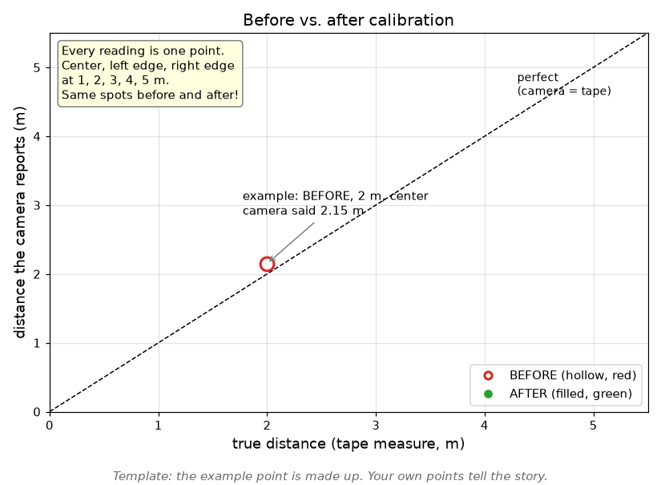

# Set up a new camera

A new camera works straight out of the box, **sort of**. In this
chapter you'll set one up, **measure how wrong it is**, calibrate it,
and **measure again**. Then you'll see for yourself what calibration
buys you.

Do this in pairs, with a mentor.

**No new camera?** Make one: with a mentor, pick an existing camera and
**remove its calibration**. On a branch in your fork, delete that Pi's
entry from the camera calibration list in the Pi code (ask a mentor
where), and deploy it. Now it's a "new" camera, and you'll rebuild its
calibration from scratch. Keep the old numbers somewhere safe: at the
end, compare yours with them!

## Why it matters

Our code turns **pixels** in the picture into **distances and angles**
in the real world. To do that, it needs to know two things about the
camera:

| | What it is | Example |
| --- | --- | --- |
| **Intrinsics** | The camera's *own* properties: how "zoomed in" it is (**focal length**), where the true **center** of the picture is, and how much the lens **bends** the picture (**distortion**) | "1 meter at 10 m away looks 94 pixels wide" |
| **Extrinsics** | Where the camera is **on the robot**, and which way it points | "30 cm forward of the robot's center, 50 cm up, tilted 10° up" |

**Every physical camera is a little different**, even two of the same
model with the same lens: the lens never sits exactly centered over the
sensor. Our code has calibrated numbers for each camera we use, and they
really do differ. Here's what the difference means at the
[Vision Shooter Challenge](18_VISION_SHOOTER_CHALLENGE.md) distance:

* The **center** of the picture is off by about **20 pixels** between
  two of our cameras.
* The camera turns pixels into angles: 20 pixels ÷ about 940 (focal
  length, in pixels) ≈ **0.02 radians ≈ 1.2°**.
* At **10 m**, 1.2° is about **20 cm** sideways. That can be the
  difference between the ball landing in the bucket and hitting its rim.

The same mistake makes the robot think it's **somewhere it isn't**
([Where am I?](../part4/19_LOCALIZATION.md)), which ruins auton.

> **Check yourself:** with that 1.2° error, how far off would the robot
> be about a tag that's 2 m away? 5 m away? Why does calibration matter
> more far away?

## Step 1: Set up and label

1. **Label the camera** with a number on masking tape, and write down
   which Pi it goes with. Our calibration numbers belong to the camera
   **plugged into a particular Pi**, so if cameras get swapped between
   Pis, the numbers are silently wrong.
1. Set up the Pi ([pi_setup.md](https://github.com/Team100/all26/blob/main/raspberry_pi/doc/pi_setup.md)),
   and add it to the identity list
   ([how](14_PI_CHANGES.md#2-make-your-change)), with a mentor.
1. Deploy, and look at the app's output (`app.stdout` on the `:9001`
   page). Find this:

   ```
   #  CAMERA INTRINSIC IS NOT CALIBRATED!   #
   #  YOU MUST CALIBRATE IT!!!!             #
   ```

   That means the camera runs on **borrowed** numbers from a typical
   camera. That's your **BEFORE**.

**Checkpoint:** the camera works on `:1181`, and you found the warning.

## Step 2: See focal length with a ruler

Before any software, find the focal length yourself. It's just one
division.

1. Hold an AprilTag, facing the camera, exactly **2 m** away (tape
   measure). Measure the tag's real width (the black square), in meters.
1. On a screenshot of the `:1181` view, measure how many **pixels**
   wide the tag looks.
1. **Focal length (in pixels) ≈ pixels wide × distance ÷ real width.**

> **Check yourself:** our typical cameras are about 940. What did you
> get? Do it again at 4 m. Do you get the same number? (You should,
> roughly. Why?)

## Step 3: BEFORE: measure how wrong it is

Measure the camera with its borrowed numbers. Be careful and exact:
you'll repeat **exactly** the same test after calibrating.

1. Put the tag at **1, 2, 3, 4, and 5 m** from the camera, measured
   with a tape measure.
1. At each distance, put the tag in **three spots** in the picture: the
   **center**, near the **left edge**, and near the **right edge**. Mark
   each spot on the floor with tape, so you can find it again.
1. At each spot, write down the distance the **camera reports** (in
   Glass, or from your code).

| Distance | Spot | Camera says (BEFORE) | Error (BEFORE) | Camera says (AFTER) | Error (AFTER) |
| --- | --- | --- | --- | --- | --- |
| 1 m | center | | | | |
| 1 m | left | | | | |
| 1 m | right | | | | |
| 2 m | center | | | | |
| … | | | | | |

Then put each reading on this graph, as a **hollow red** point:



> **Check yourself:** are the edges worse than the center? Is far worse
> than near?

## Step 4: Calibrate

Calibration means showing the camera something whose shape you know
**perfectly**, from lots of angles, and letting a program work out the
camera's real numbers. We use a program called **mrcal** and a printed
**checkerboard**.

1. Print the checkerboard, and mount it **perfectly flat** (on a stiff
   board). A wavy board gives wrong numbers.
1. Take about **30 pictures** with the camera: near and far, tilted
   different ways, and with the checkerboard in **every part** of the
   picture, especially the **corners** (that's where distortion is).
1. Run mrcal on the pictures. It gives you the camera's focal length,
   center, and distortion, plus a number for how well it fits.
1. With a mentor, add the numbers to the Pi code for **this** Pi, with
   today's date, and deploy.

> **TODO (mentors):** the exact mrcal steps, checkerboard file, and fit
> number that's "good enough". The code refers to a `doc/calibration.md`
> in `all26` that doesn't exist yet: writing it would help every future
> team.

**Checkpoint:** the "NOT CALIBRATED" warning is gone. Compare mrcal's
focal length with your ruler number from Step 2. If you "reset" an
existing camera, compare your new numbers with its old ones too: how
close did you get?

## Step 5: AFTER: measure again

Repeat Step 3 **exactly**: same distances, same three spots, same
tape marks. Fill in the AFTER columns, and add each reading to the same
graph as a **filled green** point.

Then work out, for BEFORE and AFTER:

* the **average error** (in cm), at the center and at the edges
* the **biggest error** anywhere

**Checkpoint:** post your before-and-after graph and your two averages
to **`#rookie_training`**. How much better did it get? Where did it
help most?

## Step 6: Extrinsics: where is the camera on the robot?

Now tell the robot where its new camera is.

1. With a tape measure, measure the camera's position from the robot's
   **center**: how far **forward**, how far **left**, how far **up**.
1. Measure which way it points: how much it's **tilted** up or down,
   and **turned** left or right.
1. **Check it with a tag:** put a tag at a spot you measured from the
   robot's center. Does the robot's estimate of where the tag is match
   your tape measure? If not, which of your measurements is off?

> **TODO (mentors):** where the robot code keeps camera positions, and
> how to use the "camera to tag" values in Glass for this check.

## When do you have to do this again?

| Change | Calibrate intrinsics again? |
| --- | --- |
| A new camera, even the same model | **Yes** |
| Swap or refocus the lens | **Yes** |
| Change the camera's resolution or mode | **Yes** |
| Move the camera to a different Pi, or swap cameras between Pis | **Yes**, or move its numbers to match |
| Move the camera on the robot | No, but redo **extrinsics** (Step 6) |

Next: [Break the cameras (on purpose)](17_BREAK_THE_CAMERAS.md)
