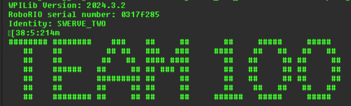

# Robot identity

We run **the same code** on many different robots and test boards. How
does the code know which robot it's on, and therefore which motors to
expect? Each controller has a **serial number**, and
[`Identity.java`](https://github.com/Team100/all26/blob/2027/lib/src/main/java/org/team100/lib/config/Identity.java)
maps serial numbers to names like `TEST_BOARD_1` or `DEMO_BOT`. Factory
code then switches on the identity.

If code behaves differently on two robots, identity is usually why.

## Find the serial number

The SystemCore doesn't report its serial number the way the RoboRIO did,
so we read it from Linux (see
[`SerialNumber.java`](https://github.com/Team100/all26/blob/2027/lib/src/main/java/org/team100/lib/framework/SerialNumber.java)).
Pick one of these:

* **From the console.** Deploy any project that calls `Startup.start()`,
  open the Driver Station console, and look near the **TEAM 100** banner
  for the `Identity:` line. If the robot is unknown, you'll also see:
  ```
  *** Using Identity UNKNOWN for serial number 35af8fca4c12ad8e
  ```
  (Ignore the "RoboRIO serial number:" line; it's blank on SystemCore.)

  

* **Over ssh** ([how](22_SYSTEMCORE.md#6-ssh-into-the-systemcore)):
  ```
  cat /sys/firmware/devicetree/base/serial-number; echo
  ```

## Add or change an identity

1. Make a branch in your fork.
1. Open `Identity.java` and search for your serial number.
   * **Found:** that's the robot's current identity. If it's wrong
     (e.g. the controller moved to a different robot), move the serial
     number to the right name.
   * **Not found:** add a new line, keeping the list in order, e.g.
     ```java
     TEST_BOARD_7("0123456789abcdef"),
     ```
1. Deploy and check that the `Identity:` line in the console changed.
1. Commit, push, and open a PR. Identity changes affect everyone, so say
   which physical robot the SystemCore is in.

> **Check yourself:** search `lib` for `Identity.instance`. What does the
> code do differently for your new identity? What would you need to
> change so it gets the right motors?

Raspberry Pis have their own identity list for the same reason; see
[Pi changes](../part3/14_PI_CHANGES.md#2-make-your-change).

Next: [Put it together on the demo bot](25_DEMO_BOT_SYSTEMCORE.md)
